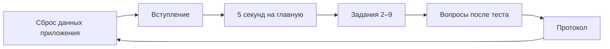

# Коридорное тестирование приложения «Петрович»
_Статус: черновик | Версия: 0.2 | Дата: 2026-10-21_

План быстрого юзабилити-теста Android-приложения на 5 людях не из команды: 9 заданий по 15 минут на человека,
в демо-режиме. Тест проверяет, понятен ли интерфейс без подсказок, и закрывает гипотезу P-2 о правиле
«10 секунд». Нужна ли продукту такая ценность — тест не покажет, это задача интервью с владельцами парков.

Источники: `mobile_analytics_screens.md` v1.0 (экраны 3.1–3.17), `app_implementation.md` v0.1 (что сделано в
коде), `brd_petrovich_mvp_full.md` v1.3 (§2.3 «10 секунд», риск R-7), `notes_product_architecture.md` v0.1
(гипотеза P-2), `CJM_Petrovich_v2.md` v2.0.

---

## 1. Что проверяем

| # | Вопрос | Откуда | Задания |
|---|---|---|---|
| В-1 | Понимает ли человек за 10 с по главной: всё ли в порядке, сколько проблем, какая главная | BRD §2.3, P-2, R-7 | 1 |
| В-2 | Проходит ли основной путь разбора без подсказок: событие → «Разберись» → звонок или письмо → итог | Экраны §1 | 3, 4, 6 |
| В-3 | Понятны ли метки «Срочно / Внимание / Мелочь», «В работе», «Ложная» | Экраны §1 | 3, 5, вопросы после теста |
| В-4 | Понятен ли график-доказательство в карточке события | Экран 3.6 | 3 |
| В-5 | Находит ли человек доклад, машину, настройку уведомлений | Экраны 3.4, 3.12, 3.17 | 2, 8, 9 |
| В-6 | Понятно ли, что умеет чат и чего не умеет | Экран 3.11 | 7 |

## 2. Формат

- **Участники:** 5 человек не из команды, которые не видели приложение. Лучше — те, кто управляет людьми или
  техникой и не работает с телематикой: так ближе к владельцу парка из `User Segmentation.md` v1.0.
- **Длительность:** 15 мин на человека: 2 мин вступление, 10 мин задания, 3 мин вопросы.
- **Роли:** ведущий даёт задания и молчит; наблюдатель пишет протокол (§5). Один человек справится, но
  пропустит детали.
- **Метод:** «думать вслух». Ведущий не подсказывает и не объясняет интерфейс. Застрял дольше 1 мин —
  задание считается проваленным, ведущий показывает путь и переходит к следующему.
- **Устройство:** Android-телефон с отладочной сборкой, демо-режим. Демо выбрано, чтобы не зависеть от сети и
  AutoGRAPH, и потому что только в демо есть сливы с графиком и схема маршрута.

## 3. Подготовка

1. Собрать отладочную сборку из `../petrovich` (`scripts/run.sh` или Android Studio) и установить на телефон.
2. Перед каждым участником — стереть данные приложения (Настройки Android → Приложения → «Петрович» →
   Хранилище → Очистить), пройти первый запуск с демо-данными, разрешить уведомления.
3. В «Настройки → Кому звонить и писать» завести двух сотрудников: «Начальник СБ» и «Бухгалтер», телефон и
   почта — тестовые, принадлежат команде.
4. Нажать «Проверить сейчас» во вкладке «Проблемы» и убедиться, что в ленте есть срочный слив топлива.
   Демо-данные меняются со временем: записать номер машины со сливом — он нужен для заданий 3–6.
5. Распечатать протокол (§5) на каждого участника.

Вступление ведущего, дословно: «Это приложение для владельца грузового автопарка. Мы проверяем приложение, а не
вас: если что-то непонятно — это ошибка приложения. Говорите вслух, что думаете и что ищете. Я не буду
подсказывать».

## 4. Задания

Формулировки — для участника, дословно. Названия кнопок вслух не произносить.

| # | Задание | Успех | Экраны |
|---|---|---|---|
| 1 | Ведущий показывает главную 5 с и убирает телефон: «Всё ли в порядке с парком? Сколько проблем? Какая главная?» | Ответил верно на все три вопроса | 3.2 |
| 2 | «Утром вам пришёл доклад за сутки. Узнайте, сколько топлива потратил парк» | Открыл доклад и назвал литры | 3.2 → 3.4 |
| 3 | «Похоже, у одной машины слили топливо. Найдите её и расскажите, что произошло и когда» | Открыл карточку события, по графику объяснил падение и назвал время | 3.5 → 3.6 |
| 4 | «Сообщите об этом в службу безопасности» | Через «Разберись» дошёл до звонка или письма в СБ | 3.7 → 3.8 или 3.9 |
| 5 | «Выяснилось, что другая срочная проблема — ошибка датчика. Отметьте это» | Нажал «Ложная» и выбрал «Ошибка датчика» | 3.6 |
| 6 | «Вернёмся к сливу. СБ проверила: слив подтвердился, водителю вычли из премии. Завершите разбор» | Закрыл разбор с итогом «Слив подтвердился» и мерой «Вычли из премии» | 3.10 |
| 7 | «Спросите Петровича, что было с парком за неделю» | Получил ответ с числом проблем за неделю. Если Петрович не понял — записать формулировку дословно | 3.11 |
| 8 | «Найдите машину Н630ВЕ196 и узнайте, сколько у неё топлива в баке» | Нашёл через «Парк» и назвал литры | 3.12 → 3.13 |
| 9 | «Сделайте так, чтобы ночью приложение беспокоило только по срочному» | Нашёл «Тихие часы» и понял, что они уже включены | 3.17 |

Вопросы после теста:
1. Что значат метки «Срочно», «Внимание», «Мелочь»? Чем «В работе» отличается от «Закрыто»?
2. Что было самым непонятным?
3. Если бы у вас был парк, чего вам здесь не хватило бы?

## 5. Протокол

Один лист на участника. Время — от конца фразы ведущего до результата.

| Задание | Справился | Время, с | Где застрял, что искал | Цитата |
|---|---|---|---|---|
| 1 | сам / с подсказкой / нет | | | |
| … | | | | |

Справился: **сам** — без вопросов к ведущему; **с подсказкой** — после наводящего вопроса; **нет** — ведущий
показал путь.

## 6. Как оценивать находки

| Серьёзность | Признак | Что делать |
|---|---|---|
| Критично | 2 и больше участников из 5 не справились с заданием | Исправить до пилота |
| Серьёзно | Справились, но с подсказкой или дольше 1 мин; или 1 из 5 не справился | В бэклог с приоритетом |
| Косметика | Справились, но споткнулись о слово, иконку, цвет | В бэклог |

Задание 1 считается пройденным для гипотезы P-2, если 4 участника из 5 ответили верно на все три вопроса.

## 7. Что не считается находкой

Известные ограничения кода (`app_implementation.md` v0.1). Если участник на них наткнулся — записать цитату,
но не заводить как ошибку интерфейса:
- в приложении нет рублей и водителя;
- «Позвонить» открывает системную звонилку, а письмо — почтовый клиент телефона;
- кнопка «Напомнить утром» в уведомлении открывает событие, отложенной доставки нет;
- чат по умолчанию работает без LLM и понимает ограниченный набор вопросов;
- ответы в чате не озвучиваются;
- на реальных данных карты нет — в демо видна схема маршрута.

## 8. Результаты

Заполняется после теста с людьми. Синтетический прогон по коду (раунд 0, вымышленные участники) —
`hallway_testing_synthetic.md` v0.1: его находки Н-1…Н-11 — гипотезы для наблюдателя, сюда как результаты не переносятся.

| Находка | Экран | Сколько из 5 | Серьёзность | Предложение |
|---|---|---|---|---|
| | | | | |

Итог по вопросам В-1…В-6 — одной строкой на вопрос: подтвердилось или нет, сколько участников.

## 9. Открытые вопросы

- [ ] Кто участники и где искать 5 человек вне команды?
- [ ] Когда тест и на каком телефоне? Нужна ли запись экрана (с согласия участника)?
- [ ] Нужен ли второй раунд на реальных данных AutoGRAPH после исправлений?
