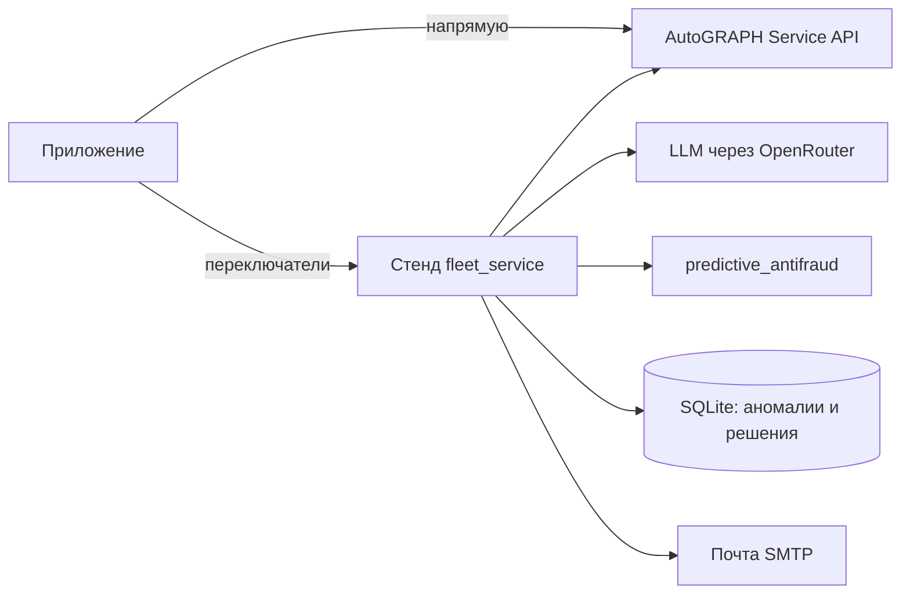
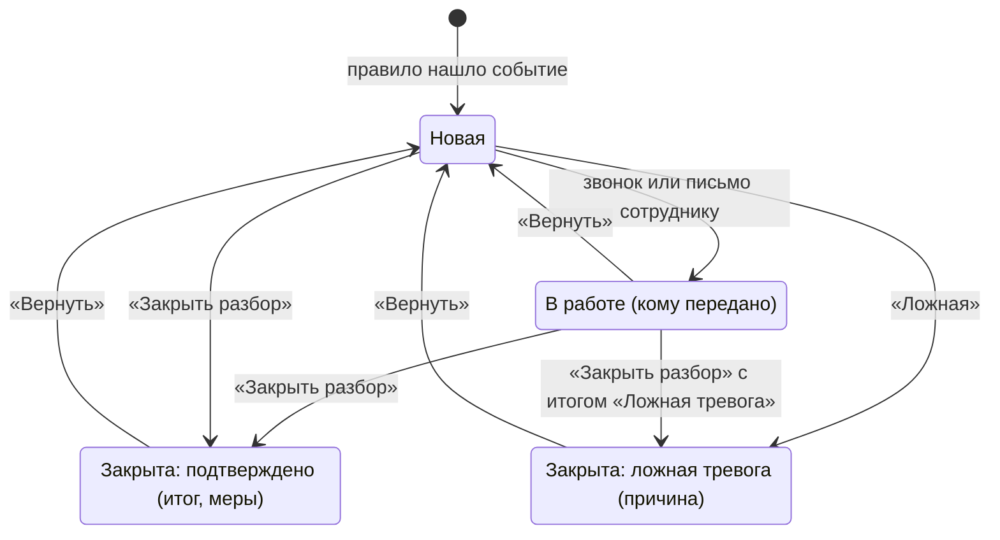

# Реализовано в коде: мобильное приложение и стенд «Петрович»
_Статус: актуально на коммит 7aa8c04 | Версия: 0.1 | Дата: 2026-10-20_

Что на самом деле умеют Android-приложение и стенд из репозитория `../petrovich` на коммит `7aa8c04`
(origin/main, 2026-10-09). Документ описывает факт, а не цель. Целевые экраны — `mobile_analytics_screens.md`
v1.0, требования — `brd_petrovich_mvp_full.md` v1.3, расхождения с требованиями — BRD §7.5.
История изменений кода — `petrovich_changes.md` v1.1.

Источники: код и `../petrovich/README.md`, описание экранов `Petrovich_ekrany_prilozheniya2.docx`
(номера экранов 3.1–3.17 ниже — оттуда).

## 1. Состав

| Часть | Что это | Состояние |
|---|---|---|
| Android-приложение | Kotlin, Jetpack Compose, minSdk 26. Работает само, без сервера | Основная часть, все экраны ниже |
| Стенд `ml/fleet_service` | FastAPI: LLM-ассистент, телеметрия, правила, хранилище аномалий, фоновая проверка, письма | Подключается в приложении переключателями, по умолчанию выключен |
| `ml/predictive_antifraud` | Сервис ML-проверки, вызывается стендом | Каркас: API и признаки есть, обученной модели нет |
| Демо-режим | 10 синтетических машин со встроенными аномалиями | Выбирается при первом запуске |

Данные из AutoGRAPH берутся методами `Login`, `EnumSchemas`, `EnumDevices`, `EnumParameters`, `GetTripTables`.
Точки приходят каждые ~10 с, приложение запрашивает только нужные параметры частями по 6 ч и сворачивает их в
интервалы 1/2/5/15 мин для периодов 6 ч / 24 ч / 3 дня / 7 дней.

## 2. Чего нет в данных

Эти ограничения определяют, что приложение не показывает, хотя это есть в требованиях.

| Чего нет | Почему | Что из-за этого не сделано |
|---|---|---|
| Рубли | Цена топлива нигде не задаётся. В описании экранов прямо: «Рублей нет: цену топлива и потери мы не знаем» | Потери ≈ ₽ на главной, в push, в отчёте, в карточке |
| Координаты, адреса, геозоны | Используемые методы Service API не отдают lat/lon и геозоны | «Где» в карточке события и машины; карта 3.14 на реальных данных; типы A-3, A-4 |
| Водитель | Не запрашивается | Поле «водитель» в push и карточке |
| Обученная ML-модель | Нет в репозитории | Работают только правила с порогами |

## 3. Экраны

Нижняя навигация — 5 вкладок: **Главная / Парк / Петрович / Проблемы / Настройки**.

| № | Экран | Состояние | Отличие от описания экранов |
|---|---|---|---|
| 3.1 | Первый запуск: знакомство → проверка парка → первые находки; экран ошибки подключения | Есть | История и первые находки — за 7 дней, а не за 90. Выбора времени доклада на шаге 3 нет |
| 3.2 | Главная: статус, плитки «На линии / Стоят / Без связи», «Требует внимания», виджеты, «Доклад на ЧЧ:ММ» | Есть | Плитки считаются по телеметрии с последней проверки (скорость последней точки, свежесть данных), а не по живому статусу трекера |
| 3.3 | Уведомления: история по дням, «Прочитать все», пример срочного уведомления | Есть | Кнопка «Напомнить утром» в push открывает событие, как «Разберись»: отложенной доставки нет |
| 3.4 | Доклад: итог фразой, 4 показателя (топливо, пробег, холостой ход, заправки), «Слушать» | Есть | Озвучка — системным синтезатором речи; без русского синтезатора на телефоне кнопка не работает |
| 3.5 | Проблемы: вкладки «Новые / В работе / Закрыты», проверка вручную | Есть | — |
| 3.6 | Карточка события: факты, график параметра ±3 ч, чек-лист «скорость и зажигание», «Петрович помнит», «Что делать» | Есть | Строки «где» нет. «Обычного расхода» нет — нет такого правила |
| 3.7 | Разбор с Петровичем: вывод, факты, три действия | Есть | — |
| 3.8 | Звонок сотруднику | Частично | Открывается системная звонилка с номером из настроек. Экрана «Идёт разговор» и отправки карточки сотруднику нет. После звонка событие переходит «В работу» |
| 3.9 | Письмо в СБ | Частично | Черновик с PDF-вложением открывается в почтовом клиенте телефона, отправляет сам владелец. Прочтение письма не отслеживается. Отчёт бухгалтеру — только черновиком из чата |
| 3.10 | Ход разбора и итог | Есть | Шаг «СБ открыла письмо» не появляется: данных о прочтении нет |
| 3.11 | Диалог с Петровичем | Есть | По умолчанию отвечает локальный ассистент по правилам, без LLM (см. §6). Голосовой ввод — системным распознавателем. Ответы в чате не озвучиваются |
| 3.12 | Парк: поиск по номеру, фильтры по статусу и базам | Есть | Базы — группы машин AutoGRAPH |
| 3.13 | Карточка машины: в баке, пробег и холостой ход за период, связь, датчик топлива | Есть | Строки «где» нет |
| 3.14 | Машина на карте | Заглушка | На реальных данных — сообщение «Петрович пока не получает координаты». Схема маршрута рисуется только в демо-режиме |
| 3.15 | Подробная сводка виджета | Есть | — |
| 3.16 | Выбор виджетов: топливо, холостой ход, пробег, заправки, без связи, топливо грузовых | Есть | — |
| 3.17 | Настройки: доклад, уведомления, контакты, помощь, «Подключение и данные» | Есть | — |
| — | Таблицы и графики по топливу, аккумулятору, двигателю, движению | Есть | Нет в описании экранов. Вход с главной и из карточки события |

## 4. Аномалии

Правила работают на телефоне. При «Аномалии со стенда» те же правила считает стенд, совпадение проверено на
эталонах `testdata/golden/`. Правила по двигателю срабатывают только при включённом зажигании.

| Код | Название | Условие | Уровень |
|---|---|---|---|
| `drain` | Слив топлива | AutoGRAPH сам зафиксировал слив (`TankMainFuelDnVol` > 0) | Срочно |
| `drop` | Резкое падение уровня топлива | Уровень упал на ≥ 25 л за 15 мин | Срочно |
| `nodata` | Нет данных | Датчик уровня топлива за всё окно проверки не дал ни одного значения | Внимание |
| `power` | Пропадание питания | Основное питание трекера пропало: < 2 мин — «Мелочь», ≥ 2 мин — «Внимание» | Мелочь / Внимание |
| `volt` | Напряжение вне нормы | Дольше 5 мин на работающем двигателе вне 12–15 В или 24–30,5 В (бортсеть определяется сама) | Внимание / Срочно |
| `overheat` | Перегрев двигателя | ОЖ > 100 °C дольше 2 мин; > 105 °C — срочно | Внимание / Срочно |
| `oil` | Низкое давление масла | < 100 кПа при > 800 об/мин дольше 1 мин | Срочно |
| `brake` | Низкое давление в тормозной системе | < 550 кПа дольше 10 мин на работающем двигателе | Внимание |

Уровни в коде и в интерфейсе: «Критично» = «Срочно» (High), «Предупреждение» = «Внимание» (Medium),
«Инфо» = «Мелочь» (Low).

Из типов BRD §4.0 сделаны A-1 (слив — `drain`, `drop`) и частично A-2 (отказ ДУТ — `nodata`, только полное
молчание датчика). A-3, A-4, A-5 и «перерасход» не сделаны. Типы `power`, `volt`, `overheat`, `oil`, `brake` —
техническое состояние машины, в BRD их нет.

## 5. Жизненный цикл аномалии

- Итог разбора: «Слив подтвердился», «Водитель объяснил — не слив», «Ложная тревога». Первые два записываются
  как «Подтверждено», третий — как «Ложная тревога».
- Меры для подтверждённого (можно несколько): «Вычли из премии», «Опломбировали бак», «Провели беседу», «Без мер».
- Причины ложной тревоги: «Штатная работа», «Ошибка датчика», «Уже известно», «Другое».
- У события есть журнал разбора: когда нашли, когда открыли, звонок, письмо, напоминание, итог.
- Повтор подавляется только для того же события: id включает машину, параметр и время начала. Новый эпизод того
  же типа на той же машине придёт снова, даже после «Ложной».
- С хранилищем на стенде решение общее для всех пользователей схемы, в карточке видно, кто и когда решил.

## 6. Уведомления, доклад, чат

**Проверка и push.** Фоновая проверка раз в 15 мин за последние 3 ч по всем машинам, плюс кнопка «Проверить
сейчас». Push приходит для «Срочно» и «Внимание», «Мелочь» не пушится. Заголовок: «Срочно · X452: Слив
топлива». На экране блокировки — только «Обнаружены аномалии», без названий машин.

| Настройка | По умолчанию |
|---|---|
| Тихие часы | Включены, 22:00–07:00: ночью приходят только срочные |
| Лимит push | Не больше 3 несрочных в сутки, срочные без ограничения |
| Доклад | 08:00, Пн–Пт, текст и голос. Push уходит при первой фоновой проверке после назначенного времени (точность до 15 мин) |

**Доклад** — за последние 24 ч: итог фразой («N из M машин без замечаний… Ждут решения: K»), топливо (л),
пробег (км), холостой ход (ч), число заправок, список случаев.

**Чат.** Два режима:
- По умолчанию — локальный Петрович, подписан «без внешней ИИ-модели». Отвечает по правилам и данным парка: всё
  ли в порядке, конкретная машина, аномалии за неделю, у кого больше всего аномалий, связь, «было ли раньше».
  Готовит черновик письма в СБ или отчёта бухгалтеру, предлагает передать случай механику. На вопрос вне этих тем
  отвечает «Не уверен, что понял вопрос».
- «Ассистент через стенд» — отвечает LLM через OpenRouter. Числа берёт из инструментов стенда: список машин,
  сводка по машине, проверка машины, лента аномалий, карточка аномалии. При «Письмах из чата» готовит черновик,
  письмо отправляет стенд только по кнопке «Отправить» и только адресатам из списка на стенде.

## 7. Стенд: переключатели в приложении

Все в «Настройки → Подключение и данные → Стенд». Работают только вне демо-режима.

| Переключатель | Что меняется |
|---|---|
| Ассистент через стенд | Чат отвечает LLM на стенде |
| Письма из чата | Ассистент на стенде готовит письма, отправляет стенд по SMTP |
| Данные через стенд | Таблицы, графики, сводка и проверка берут телеметрию со стенда |
| Аномалии со стенда | Правила считает стенд, плюс вызов ML-сервиса |
| Хранить аномалии на стенде | Лента и решения — на стенде (SQLite), решение общее для схемы, есть автор решения |
| Фоновая проверка на стенде | Стенд проверяет машины по расписанию без телефона; пароль AutoGRAPH уходит на стенд только с согласия и хранится зашифрованным |

Ключи OpenRouter есть только на стенде, в приложении их нет. Без TLS приложение ходит на стенд только в
отладочной сборке.
