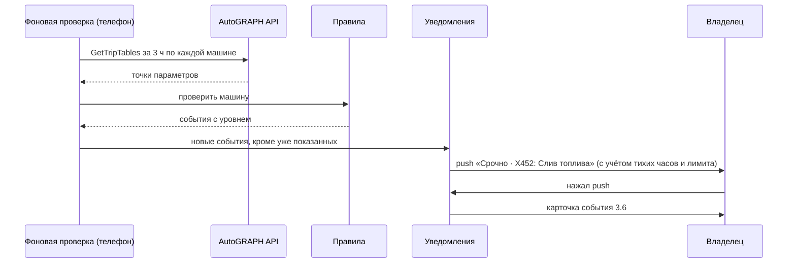

# Спецификация мобильного приложения «Петрович»
_Статус: черновик на согласование | Версия: 0.1 | Дата: 2026-10-21_

Системная спецификация Android-приложения владельца парка для разработки и приёмки: функциональные требования
с критериями приёмки, интеграции, правила расчёта, хранение данных, ошибки и нефункциональные требования. У каждого
требования указано, что уже есть в коде `../petrovich` на коммит `7aa8c04` (origin/main, 2026-10-09).

Чего здесь нет и где это искать: внешний вид и тексты экранов — `mobile_analytics_screens.md` v1.0 (нумерация
экранов 3.1–3.17 — оттуда); бизнес-цели и приоритеты — `brd_petrovich_mvp_full.md` v1.3; подробности
реализованного — `app_implementation.md` v0.1. При расхождении: требования — BRD, экраны — `mobile_analytics_screens.md`,
факт — код. Приоритеты в этом документе не назначаются: столбец «BRD» ссылается на требование-источник.

Состояние: **Есть** — работает в `origin/main`; **Частично** — работает с ограничением из столбца «Примечание»;
**Нет** — не сделано; **Стенд** — работает только при включённом переключателе стенда (§3.2).

## 1. Границы системы

| Часть | Что делает | Где |
|---|---|---|
| Android-приложение | Экраны, проверка машин по правилам, уведомления, доклад, локальный ассистент, хранение решений | `app/` — Kotlin, Jetpack Compose, minSdk 26 |
| AutoGRAPH Service API | Источник телеметрии: машины, параметры, точки ~каждые 10 с | Сервер заказчика (АвтоГРАФ.WEB 2023.2.3.28+) |
| Стенд `fleet_service` | LLM-ассистент, телеметрия и правила на сервере, общее хранилище решений, фоновая проверка, письма | `ml/fleet_service/` — FastAPI, SQLite. Необязателен: по умолчанию выключен |
| Демо-режим | 10 синтетических машин со встроенными событиями, без сети | Внутри приложения |

Пользователь один — владелец парка (BRD NFR-S5). Видит только машины своей схемы AutoGRAPH (NFR-S4).

## 2. Функциональные требования

### 2.1 Подключение и первый запуск (3.1)

| ID | Требование | Критерий приёмки | BRD | Состояние | Примечание |
|---|---|---|---|---|---|
| F-ONB-1 | Вход по логину и паролю AutoGRAPH; выбор схемы, если их несколько | Верные данные → список машин схемы; нет схем → «Для этого логина нет доступных схем» | §6.3 | Частично | Берётся первая схема, выбора нет |
| F-ONB-2 | Демо-режим без учётной записи | «Попробовать на демо» → 10 машин и события без сети | §4 | Есть | — |
| F-ONB-3 | Проверка парка: машины на связи, загружена ли история, машины без связи, молчащие датчики топлива | Шаг 2 показывает каждую группу числом и списком номеров; по машинам с молчащим датчиком топливо не считается | 3.1 | Есть | — |
| F-ONB-4 | Первые находки за период истории | Шаг 3 показывает события за период или «Ничего не нашёл» | 3.1 | Частично | Период 7 дней, в описании экранов — 90 |
| F-ONB-5 | Выбор времени доклада на шаге 3 | Выбранное время сохраняется в настройках доклада | 3.1 | Нет | Настраивается только в 3.17 |
| F-ONB-6 | Ошибка подключения простыми словами | Неверный логин или пароль, нет сети, сервер ниже 2023.2.3.28 — у каждого случая свой текст «что случилось и что сделать» и код для поддержки | 3.1 | Частично | **Любая** ошибка входа, включая неверный пароль и нет сети, показывается как «у вашего дилера старая версия сервера»; различает их только код для поддержки |

### 2.2 Главная и статус парка (3.2)

| ID | Требование | Критерий приёмки | BRD | Состояние | Примечание |
|---|---|---|---|---|---|
| F-HOME-1 | Статус парка одной фразой с цветом и текстом | Цвет по правилу §4.2; цвет всегда продублирован текстом («2 проблемы», «Всё в порядке») | A, NFR-P1 | Есть | — |
| F-HOME-2 | Свежесть данных | Под статусом — «данные на ЧЧ:ММ»; если стенд давно не проверял — карточка «Стенд давно не проверял данные» | 3.2 | Есть | — |
| F-HOME-3 | Плитки «На линии / Стоят / Без связи» с переходом в «Парк» с фильтром | Сумма плиток = число машин; нажатие открывает 3.12 с этим фильтром | 3.2 | Частично | Считается по последней проверке (§4.1), а не по живому статусу трекера |
| F-HOME-4 | Блок «Требует внимания»: новые события, кнопка «Разобрать с Петровичем» | Показаны события в статусе «Новое», сначала «Срочно» | A | Есть | — |
| F-HOME-5 | Виджеты владельца (3.15, 3.16) | Добавить, убрать, открыть подробную сводку; по умолчанию — топливо и холостой ход | A | Есть | Расчёт — §4.3 |
| F-HOME-6 | Потери в ₽ | Сумма в ₽ рядом с литрами | 1.3, A | Нет | Нет цены топлива в данных (Q-7) |

### 2.3 Проверка машин и события

| ID | Требование | Критерий приёмки | BRD | Состояние | Примечание |
|---|---|---|---|---|---|
| F-EVT-1 | Фоновая проверка всех машин | Раз в 15 мин за последние 3 ч; работает при закрытом приложении и после перезагрузки | C, NFR-P5 | Есть | WorkManager |
| F-EVT-2 | Ручная проверка | «Проверить сейчас» на 3.5 запускает ту же проверку и показывает прогресс | 3.5 | Есть | — |
| F-EVT-3 | Типы событий и пороги | Правила из `app_implementation.md` §4 (`drain`, `drop`, `nodata`, `power`, `volt`, `overheat`, `oil`, `brake`) дают одинаковый результат на телефоне и на стенде | §4.0 | Есть | Совпадение проверяется эталонами `testdata/golden/` |
| F-EVT-4 | Расход выше обычного | Расход машины по дням с линией «обычно»; событие «Внимание» при отклонении | A-5, 3.6 | Нет | Нужно правило расчёта «обычного» (Q-33) |
| F-EVT-5 | Поездка в нерабочее время, съезд с маршрута | — | A-3, A-4 | Нет | Нет координат и графика смен (Q-16, Q-17) |
| F-EVT-6 | Без повторов | Одно и то же событие не создаётся дважды; id = машина + параметр + время начала. Новый эпизод того же типа приходит снова | C | Есть | — |
| F-EVT-7 | Карточка события (3.6) | Главное значение крупно в цвете уровня; график параметра ±3 ч; скорость и зажигание в момент события, если машина их пишет; «Петрович помнит» — прошлые случаи на машине с итогами | B, 3.6 | Частично | Нет строки «где» (Q-17) |
| F-EVT-8 | Жизненный цикл | Статусы и переходы — по диаграмме `app_implementation.md` §5; каждый переход пишется в журнал разбора с временем | B | Есть | — |
| F-EVT-9 | Итог разбора и меры (3.10) | Итог из 3 вариантов; для подтверждённого — меры, можно несколько; для ложной — причина из 4 вариантов | B | Есть | «Водитель объяснил — не слив» пишется как «Подтверждено» (Q-34) |
| F-EVT-10 | Общие решения для схемы | С хранилищем на стенде решение видят все пользователи схемы, в карточке — кто и когда решил | NFR-S7 | Стенд | — |
| F-EVT-11 | Список «Проблемы» (3.5) | Вкладки «Новые / В работе / Закрыты» со счётчиками; счётчик новых — на вкладке навигации | B | Есть | — |

### 2.4 Уведомления и доклад (3.3, 3.4)

| ID | Требование | Критерий приёмки | BRD | Состояние | Примечание |
|---|---|---|---|---|---|
| F-PUSH-1 | Push о новых событиях «Срочно» и «Внимание» | «Мелочь» не пушится; заголовок «Срочно · X452: Слив топлива»; нажатие открывает 3.6 этого события | C | Есть | Локальные уведомления Android, не FCM |
| F-PUSH-2 | Приватность экрана блокировки | На заблокированном экране — «Обнаружены аномалии», без номеров машин | NFR-S9 | Есть | — |
| F-PUSH-3 | Тихие часы | По умолчанию 22:00–07:00; ночью приходят только «Срочно» | C | Есть | — |
| F-PUSH-4 | Лимит push | Не больше 3 несрочных в сутки, срочные без ограничения | C | Есть | Описание экранов: «3 срочных в день», BRD — иное (Q-35) |
| F-PUSH-5 | «Напомнить утром» | Push повторяется в начале рабочего времени | 3.3 | Нет | Кнопка открывает событие |
| F-PUSH-6 | История уведомлений | По дням «Сегодня / Вчера / дата», непрочитанные выделены, «Прочитать все» | 3.3 | Есть | — |
| F-REP-1 | Утренний доклад по расписанию | По умолчанию 08:00 Пн–Пт; push уходит при первой проверке после назначенного времени, опоздание ≤ 15 мин; один доклад в день | C | Есть | — |
| F-REP-2 | Содержание доклада | За последние 24 ч: итог фразой, топливо (л), пробег (км), холостой ход (ч), заправки, список случаев | C | Есть | Расчёт — §4.3 |
| F-REP-3 | Озвучка доклада | «Слушать / Пауза» читает итог и показатели по-русски | C | Частично | Системный синтезатор; без русского голоса на телефоне кнопка не работает |

### 2.5 Ассистент «Петрович» (3.7, 3.11)

| ID | Требование | Критерий приёмки | BRD | Состояние | Примечание |
|---|---|---|---|---|---|
| F-CHAT-1 | Локальный ассистент без внешней модели | Отвечает на вопросы: всё ли в порядке, о машине, события за неделю, у кого больше событий, связь, было ли раньше. Подписан «без внешней ИИ-модели». Вне тем — «Не уверен, что понял вопрос» | B | Есть | Режим по умолчанию |
| F-CHAT-2 | Ассистент на LLM | Числа только из инструментов стенда (§3.2); «нет данных» и «ноль» различаются; ответ ≤ 3 предложений | B, NFR-S8 | Стенд | Модель и разрешение на внешний сервис — Q-1 |
| F-CHAT-3 | Чат из карточки события | Ассистент получает событие и отвечает в его контексте | B | Есть | — |
| F-CHAT-4 | Голосовой ввод | Микрофон в поле ввода, распознавание по-русски | B | Частично | Системный распознаватель; ответы не озвучиваются |
| F-CHAT-5 | Действия под ответом | «Разобраться с X452», «Передать механику», черновик письма в СБ или отчёта бухгалтеру | D | Есть | — |
| F-CHAT-6 | Таймаут и запасной ответ | LLM не ответила вовремя → понятное сообщение и предложение спросить ещё раз | NFR-P4 | Частично | Таймаут стенда 60 с (чат — 100 с), в BRD — 8 с |

### 2.6 Действия наружу (3.8, 3.9)

| ID | Требование | Критерий приёмки | BRD | Состояние | Примечание |
|---|---|---|---|---|---|
| F-ACT-1 | Ничего наружу без подтверждения | Звонок, письмо и отчёт уходят только после явной кнопки владельца на экране подтверждения | D | Есть | — |
| F-ACT-2 | Звонок сотруднику | Подтверждение с именем и номером из контактов; после звонка событие «В работе — кому» | D.1 | Частично | Системная звонилка; нет экрана «Идёт разговор» и отправки карточки сотруднику |
| F-ACT-3 | Письмо в СБ с данными события | Черновик: кому, тема, текст, PDF с данными события; «Изменить», «Отправить» | D | Частично | Отправляет почтовый клиент телефона; прочтение не отслеживается |
| F-ACT-4 | Письмо из чата через стенд | Стенд отправляет по SMTP только по кнопке «Отправить» и только адресатам из списка на стенде | D | Стенд | — |

### 2.7 Парк и машина (3.12–3.14)

| ID | Требование | Критерий приёмки | BRD | Состояние | Примечание |
|---|---|---|---|---|---|
| F-PARK-1 | Список машин с поиском и фильтрами | Поиск по номеру без учёта раскладки и регистра (x452 → Х452); фильтры по статусу и базам; проблемные сверху | 3.12 | Есть | Базы — группы AutoGRAPH |
| F-PARK-2 | Карточка машины | Период «Сегодня / Неделя / Месяц»; в баке, пробег, холостой ход, последняя связь, состояние датчика топлива, текущее событие | 3.13 | Частично | Нет строки «где» |
| F-PARK-3 | Машина на карте | Маршрут, стоянки, событие на карте за «Сегодня / Вчера» | 3.14 | Нет | На реальных данных — сообщение «Петрович пока не получает координаты» (Q-17) |
| F-PARK-4 | Таблицы и графики | Топливо, аккумулятор, двигатель, движение за 6 ч – 7 дней | — | Есть | В описании экранов нет (Q-36) |

### 2.8 Настройки (3.17)

| ID | Требование | Критерий приёмки | BRD | Состояние | Примечание |
|---|---|---|---|---|---|
| F-SET-1 | Доклад: время, дни, «Только текст» или «Текст и голос» | Изменение применяется со следующего доклада | C | Есть | — |
| F-SET-2 | Уведомления: срочные, предупреждения, тихие часы, лимит | Каждая настройка меняет поведение §2.4 | C | Есть | — |
| F-SET-3 | Контакты «Кому звонить и писать» | Имя, роль, телефон, почта; используются в 3.8, 3.9 | D | Есть | — |
| F-SET-4 | Оформление | Светлая, тёмная, как в системе | — | Есть | — |
| F-SET-5 | Подключение и данные | Сменить учётную запись, перейти в демо или выйти из него, переключатели стенда (§3.2) | — | Есть | — |
| F-SET-6 | Пороги правил | Владелец меняет пороги событий | Q-29 | Нет | Пороги зашиты в код |

## 3. Интеграции

### 3.1 AutoGRAPH Service API

Справочник — `autograph_api_reference.md` (искать по методу). Клиент — `app/.../data/api/AutoGraphApi.kt`.

| Метод | Зачем | Когда |
|---|---|---|
| `Login` | Токен сессии по логину и паролю | Вход; повторно при отказе в доступе |
| `EnumSchemas` | Схемы пользователя | Вход |
| `EnumDevices` | Машины схемы и их группы (базы) | Вход, обновление парка |
| `EnumParameters` | Какие параметры пишет машина | Перед первым запросом данных по машине |
| `GetTripTables` | Значения параметров по времени | Проверка, доклад, виджеты, карточки, графики |

- Запрашиваются только нужные параметры: уровень, слив и заправка (`TankMainFuelLevel`, `TankMainFuelDnVol`,
  `TankMainFuelUpVol`), питание и зажигание (`Power`, `DIgnition`, `DIgnitionCAN`), обороты, температура ОЖ,
  давление масла, скорость, напряжение (`BattaryVOLTAGE` — так в схеме AutoGRAPH), параметры CAN для графиков.
- Длинный период режется на части по 6 ч; ответ разбирается потоково; точки сворачиваются в интервалы
  1 / 2 / 5 / 15 мин для периодов 6 ч / 24 ч / 3 дня / 7 дней.
- Таймауты: соединение 20 с, чтение 60 с.
- Время — местное время пользователя, смещение от UTC передаётся при входе.
- Координат, адресов, геозон, водителя и цены топлива используемые методы не отдают — отсюда «Нет» у F-HOME-6,
  F-EVT-5, F-PARK-3 и строки «где».

### 3.2 Стенд `fleet_service`

Адрес стенда задаётся в настройках. Вне отладочной сборки — только HTTPS. Авторизация каждого запроса:
`Authorization: Bearer <токен сессии AutoGRAPH>`, `X-Schema-Id`, `X-User-Name`. Стенд проверяет токен в AutoGRAPH
и отвечает 401, если он недействителен; приложение получает новый токен и повторяет запрос один раз. Ошибка
приходит телом `{"detail": "<текст>"}`. Ключи LLM и SMTP хранятся только на стенде.

| Переключатель в приложении | Эндпоинт | Назначение |
|---|---|---|
| — | `GET /health` | Доступен ли стенд |
| Ассистент через стенд | `POST /v1/chat` | Вопрос → ответ LLM; в запросе история диалога, смещение пояса, событие или его id; в ответе — текст и черновики писем |
| Письма из чата | `POST /v1/emails/{draft_id}/confirm`, `/cancel` | Отправить или отменить черновик |
| Данные через стенд | `GET /v1/vehicles`, `GET /v1/telemetry?vehicleId&from&to&utcOffsetMinutes` | Машины и телеметрия вместо прямых запросов к AutoGRAPH |
| Аномалии со стенда | `POST /v1/anomalies/check` | Правила и ML-сервис на стенде по одной машине за период |
| Хранить аномалии на стенде | `GET /v1/anomalies` (фильтры: период, машина, уровень, статус; `limit` ≤ 200 по умолчанию), `POST /v1/anomalies/scan`, `POST /v1/anomalies/{id}/resolve`, `POST /v1/anomalies/import` | Общая лента и решения схемы; перенос решений с телефона |
| Фоновая проверка на стенде | `POST/GET /v1/background/access`, `POST /v1/background/access/revoke`, `POST /v1/notifications/claim` | Доступ стенда к AutoGRAPH без телефона; «забрать» события для push, чтобы два устройства не уведомляли дважды |

Пароль AutoGRAPH передаётся на стенд только при `savePassword: true` после согласия владельца и хранится там
зашифрованным; отзыв доступа удаляет пароль.

### 3.3 Платформа Android

| Что | Чем | Ограничение |
|---|---|---|
| Фоновая работа | WorkManager, период 15 мин | Android может откладывать задачи в режиме экономии |
| Уведомления | Локальные уведомления, канал `anomalies` с высокой важностью | Нет FCM: при выключенном телефоне событие придёт после включения |
| Голос | Системные распознаватель и синтезатор речи | Нужен русский голос на устройстве (Q-2 закрыт так) |
| Звонок, почта | Системная звонилка, почтовый клиент через `Intent` | Отправку и звонок выполняет сам владелец |

## 4. Правила расчёта

### 4.1 Статус машины
- **Без связи** — последняя точка старше 45 мин.
- **На линии** — данные свежие, скорость последней точки ≥ 3 км/ч.
- **Стоит** — данные свежие, скорость < 3 км/ч.

Считается при каждой проверке и сохраняется; плитки главной показывают последний результат.

### 4.2 Цвет главной
Красный — есть новые «Срочно»; жёлтый — «Срочно» нет, есть новые «Внимание»; зелёный — новых событий нет;
нейтральный — «Ещё не проверял данные».

### 4.3 Показатели доклада и виджетов
Общее для всех: соседние точки с разрывом больше 2 ч не учитываются.

| Показатель | Формула | Единица |
|---|---|---|
| Топливо | Σ max(0, (уровень₀ − уровень₁) − слив + заправка) по соседним точкам | л |
| Пробег | Σ (v₀ + v₁) / 2 × Δt | км |
| Холостой ход | Σ Δt, где зажигание включено и скорость < 1 км/ч | ч |
| Заправки | Число точек с `TankMainFuelUpVol` > 1 л | шт. |
| Без связи | Число машин в статусе «без связи» | шт. |

Холостой ход считается только по машинам, которые пишут зажигание; нет таких машин — показатель пуст, а не 0.
Виджет: сумма за период «День / Неделя / Месяц», изменение к прошлому такому же периоду, мини-график, три
машины-лидера.

### 4.4 Пороги событий
По таблице `app_implementation.md` §4. Правила по двигателю работают только при включённом зажигании. Уровни
в коде и интерфейсе: «Критично» = «Срочно», «Предупреждение» = «Внимание», «Инфо» = «Мелочь».

## 5. Данные на устройстве

| Что | Где | Примечание |
|---|---|---|
| Настройки, учётная запись, контакты, раскладка виджетов, счётчики push, последний статус парка | DataStore `settings` | **Пароль AutoGRAPH хранится открытым текстом** — нарушает NFR-S2, NFR-S3 (§7) |
| События, решения, журнал разбора | Локальное хранилище событий | С «Хранить аномалии на стенде» — SQLite стенда, на телефоне кэш ленты для показа без сети |
| Уведомления | Локальное хранилище уведомлений | История 3.3, отметка «прочитано» |
| Телеметрия | Не хранится, запрашивается заново | — |

Сущности и поля — `mobile_analytics.md` v0.3, §2.

## 6. Ошибки и пустые состояния

| Ситуация | Поведение |
|---|---|
| Нет сети | Последние данные с пометкой «данные на ЧЧ:ММ»; проверка повторится в следующий запуск (NFR-P9) |
| AutoGRAPH отклонил токен | Повторный вход сохранённым паролем, затем повтор запроса |
| Неверный пароль или нет сети при входе | Нужно: свой текст на каждый случай. Сейчас — «старая версия сервера» для всех (F-ONB-6) |
| Датчик топлива молчит | Событие `nodata`; в докладе, виджетах и чате — «нет данных», не 0 |
| Машина не пишет параметр | Строка или чек-лист с этим параметром не показывается |
| Стенд недоступен или вернул ошибку | Текст из `detail` или «Стенд недоступен: проверьте адрес в настройках и сеть» |
| LLM не ответила | Сообщение о таймауте; локальный ассистент как замена — **нет** (Q-1) |
| Нет русского голоса | Кнопка «Слушать» не работает — **нужно сообщение** о том, как установить голос |
| Ещё не было проверки | Главная — нейтральный статус «Ещё не проверял данные» |

## 7. Нефункциональные требования: цель и факт

| ID BRD | Требование | В коде | Расхождение |
|---|---|---|---|
| NFR-S1 | Только HTTPS | AutoGRAPH и стенд — HTTPS; HTTP к стенду только в отладочной сборке | — |
| NFR-S2, S3 | Токен — в защищённом хранилище; пароль AutoGRAPH на устройстве не хранится | Пароль в DataStore открытым текстом, в коде пометка TODO | **Да** — нужна правка до пилота |
| NFR-S4 | Только машины своей схемы | Все запросы со схемой пользователя; стенд проверяет токен в AutoGRAPH | — |
| NFR-S7 | Аудит: кто и когда решил | Есть с хранилищем на стенде; без стенда автор не пишется | Частично |
| NFR-S8 | Данные в публичный LLM — только с согласия заказчика | LLM выключен по умолчанию; включается на стенде | Решение — Q-1 |
| NFR-S9 | ФИО водителей не уходят в LLM | Водитель не запрашивается | — |
| NFR-P1 | Статус за 10 с | Главная берёт последний сохранённый статус | Замер не проводился |
| NFR-P4 | Таймаут LLM 8 с | 60 с модель, 100 с чат | **Да** |
| NFR-P5 | High-push ≤ 15 мин | Проверка раз в 15 мин | Задержка до 15 мин плюс откладывание Android |
| NFR-P9 | Работа без AutoGRAPH | Последние данные с пометкой времени | Экспоненциального повтора нет |
| §6.5 | Android 10+ | minSdk 26 (Android 8) | Шире требования, не мешает |
| §6.5 | Статус не только цветом; системный размер шрифта | Цвет всегда с текстом; размеры в `sp` | — |
| §6.5 | События аналитики для метрик §2.2 | Не реализованы | **Да** — метрики пилота не посчитать |

## 8. Открытые вопросы

Нумерация общая с BRD §7.1.

- [ ] **Q-1.** Какая LLM и можно ли отдавать данные во внешний сервис; нужен ли локальный ассистент как запасной
  при таймауте LLM (§6).
- [ ] **Q-7.** Цена топлива и рубли (F-HOME-6).
- [ ] **Q-17.** Источник координат и геозон (F-EVT-5, F-PARK-3, строка «где»).
- [ ] **Q-33.** Правило «обычного расхода» (F-EVT-4).
- [ ] **Q-34.** Как считать итог «Водитель объяснил — не слив» (F-EVT-9).
- [ ] **Q-35.** Какой лимит push действует (F-PUSH-4).
- [ ] **Q-36.** Оставлять ли таблицы и графики (F-PARK-4).
- [ ] **Q-29.** Нужна ли владельцу настройка порогов (F-SET-6).
- [ ] Хранение пароля AutoGRAPH: Keystore на телефоне или только на стенде (NFR-S2, S3) — решение команды
  разработки, срок — до пилота.
- [ ] Таймаут LLM: 8 с из BRD реалистичен для модели с вызовом инструментов? Нужен замер на стенде (Т2 из гипотез).
- [ ] События аналитики использования: какие события и куда отправлять (BRD §2.2, §6.5).

## 9. Связанные документы

- `mobile_analytics_screens.md` v1.0 — экраны и сценарии
- `mobile_analytics.md` v0.3 — данные по экранам и сущности
- `app_implementation.md` v0.1 — что сделано в коде
- `brd_petrovich_mvp_full.md` v1.3 — требования и приоритеты; расхождения с кодом — §7.5
- `autograph_api_reference.md` — справочник AutoGRAPH API
- `petrovich_changes.md` v1.1 — журнал изменений кода
