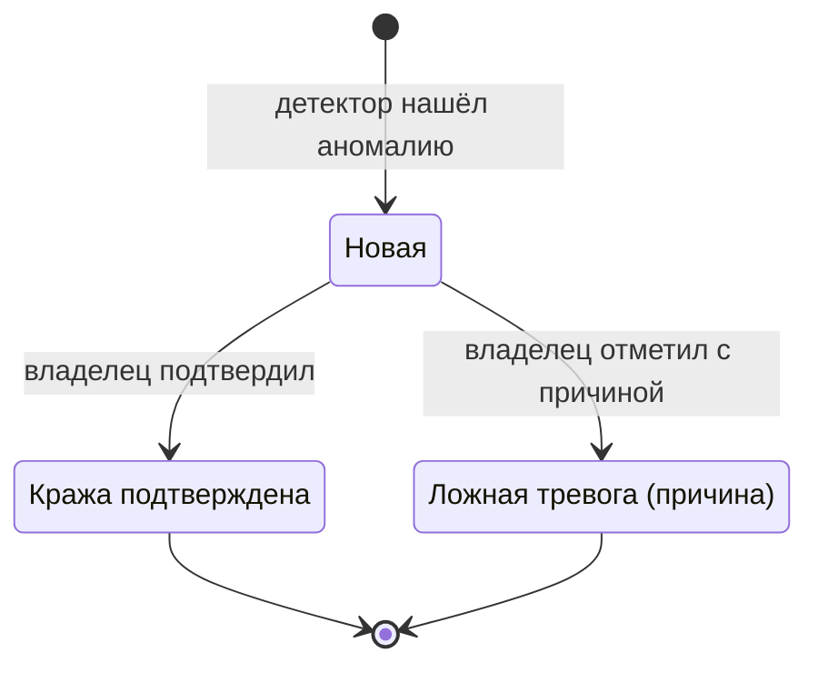

# BRD: MVP «Петрович» — ИИ-ассистент владельца автопарка
_Статус: черновик на согласование | Версия: 1.2 | Дата: 2026-10-19_

> **Как читать документ.** Это полный BRD, собранный по шаблону `SKILL/make-bizness-treb`. Он расширяет `brd_mobile_mvp.md` (v0.2) и опирается на `mobile_analytics_screens.md` (v0.4), `Analiz/PV.md`, `analytics_draft.md`, `notes_product_architecture.md`, `mvp_description.md` и концепцию «ИИ-агент Петрович v1.1».
>
> **Приоритеты требований (MoSCoW):** **M** — Must, без этого не MVP; **S** — Should, если хватит времени в 5 спринтах; **C** — Could, после MVP; **W** — Won't, в MVP сознательно не делаем.
>
> Значения в `[квадратных скобках]` — гипотезы. Их подтверждают интервью и пилот. Всё, чего нет во вводных, вынесено в §7 и не додумывается.
>
> **v1.1.** С документом объединена вторая редакция BRD v1.0 (`brd_petrovich_mvp.md`, удалена). Её детальная постановка модулей и каналов — в Приложении А, недостающие открытые вопросы — в §7.1 (Q-28…Q-32), таблица противоречий во входных документах — в §7.3, расхождения в приоритетах между редакциями — в §7.4. Приоритеты этого документа не менялись.
>
> **v1.2.** В §4.0 добавлена диаграмма жизненного цикла аномалии (Mermaid). Требования не менялись.

---

## Содержание

1. [Паспорт проекта](#1-паспорт-проекта-executive-summary)
2. [Цели и метрики успеха](#2-цели-и-метрики-успеха-goals--metrics)
3. [Архитектура решения](#3-архитектура-решения-solution-overview)
4. [Функциональные требования](#4-функциональные-требования-functional-requirements)
5. [Пользовательские сценарии](#5-пользовательские-сценарии-user-stories)
6. [Нефункциональные требования](#6-нефункциональные-требования-non-functional-requirements)
7. [Открытые вопросы и риски](#7-открытые-вопросы-и-риски-qa-and-risks)
8. [Скоуп, план и критерии готовности](#8-скоуп-план-и-критерии-готовности)
9. [Глоссарий и связанные документы](#9-глоссарий-и-связанные-документы)
10. [Приложение А. Детализация требований](#приложение-а-детализация-требований-из-второй-редакции-brd)

---

## 1. Паспорт проекта (Executive Summary)

### 1.1 Проблема

Владелец автопарка подключён к телематике (АвтоГРАФ и аналоги), и данные с машин собираются круглосуточно: координаты, скорость, уровень топлива (ДУТ), CAN-шина, моточасы. **Собирать данные проблем нет, проблема в их интерпретации.** Разбор отчётов требует времени и квалификации, поэтому нужен посредник: аналитик или диспетчер по топливу. При парке в 10–50 машин держать такого специалиста нерентабельно.

| Параметр | Значение | Источник / статус |
|---|---|---|
| Задержка обнаружения слива | `[3–10]` дней: при разборе отчётов или по перерасходу в конце месяца | PV, гипотеза |
| Время владельца на контроль топлива | `[3–5]` ч/нед | PV, гипотеза |
| Доля непроверяемых машин | `[более половины]` из-за нехватки времени | PV, гипотеза |
| Топливо на одну фуру | ~10 000 км/мес × ~33 л/100 км ≈ 3 300 л ≈ **230 тыс. ₽/мес** | PV, расчёт |
| Потери при 5 % | ≈ **11,5 тыс. ₽/мес** на машину, ≈ **2,8 млн ₽/год** на парк из 20 машин | PV, расчёт |
| Доверие к штатным детекторам | Ложные «сливы» приводят к тому, что уведомления игнорируют и реальные эпизоды пропускают | PV, замерить на пилоте |

**Корень проблемы:** телематика отвечает на вопрос «что происходило» и не отвечает на вопрос «есть ли у меня проблема, сколько она стоит и что делать». Этот разрыв закрывает «Петрович».

### 1.2 Целевая аудитория

| | **Сегмент А (основной)** | **Сегмент Б (вторичный)** |
|---|---|---|
| Роль | Собственник или директор транспортной компании | Директор или главный механик |
| Размер парка | 5–30 грузовых ТС (тягачи, самосвалы, бортовые) | 30–150 единиц техники (строительство, нефтесервис, карьеры) |
| Персонал | Нет аналитика и диспетчера по топливу | Есть механик, нет аналитика |
| Оборудование | АвтоГРАФ + ДУТ, часть машин с CAN | То же |
| География | УрФО, Пермский край, в т. ч. промысловые зоны с нестабильной связью | То же |
| Устройство | Смартфон, преимущественно Android | Смартфон + иногда ПК |

**Ключевые ограничения пользователя:**
- **Время.** Большую часть дня проводит в разъездах, за компьютером почти не сидит. На ежедневный контроль готов тратить минуты, а не часы.
- **Экспертиза.** Техническая грамотность средняя и ниже. Таблицы с сырыми данными не читает, термины телематики («тарировка», «CAN», «моточас») для него шум.
- **Ресурсы.** Нанимать аналитика не готов, решение должно окупаться быстро и наглядно (в рублях).
- **Связь.** На объектах связь может пропадать, поэтому приложение не должно показывать пустой экран.

**Не целевые:** парки без ДУТ; компании со штатным аналитиком (для них веб-интерфейс, отдельный продукт, см. `mvp_description.md`).

### 1.3 Ценностное предложение (Value Proposition)

> **«Петрович» — это топливный аналитик в кармане: сам находит, где парк теряет деньги, и говорит об этом одной фразой с суммой в рублях и доказательством.**

| Было | Стало |
|---|---|
| Раз в неделю или месяц вручную разбирать отчёты АвтоГРАФ | Утренний push в 8:00: «Вчера: 17 в норме, 3 требуют внимания, потери ≈ 12 400 ₽» |
| О сливе узнаёт через 3–10 дней, водитель успел повторить | Push о сливе через ≤ 15 мин с машиной, водителем, местом и суммой |
| Чтобы понять, есть ли проблема, нужен специалист | Ответ за 10 секунд: цвет статуса, что случилось, сколько стоит |
| Доказывать эпизод водителю сложно, данные «где-то в системе» | Готовая картинка-доказательство на весь экран, её можно показать водителю |
| Ложные тревоги приучают игнорировать уведомления | Кнопка «Ложная тревога» с причиной: повтор подавляется, модель учится |
| Непонятно, окупается ли телематика | Сумма выявленных потерь ≈ ₽ за сутки и по каждому случаю |

**Ключевые выгоды (целевые значения для парка из 20 машин):**

| Выгода | Было | Стало (цель) |
|---|---|---|
| **Время** владельца на контроль топлива | `[4]` ч/нед | `[0,5]` ч/нед |
| **Деньги**: подтверждённые выявленные потери | не измеряются | ≥ `[5 000]` ₽/мес на машину |
| **Скорость** обнаружения слива | `[3–10]` дней | ≤ 1 дня, для High ≤ 15 мин |
| **Простота** | отчёты, таблицы, специалист | одна кнопка, один экран, человеческий язык |

---

## 2. Цели и метрики успеха (Goals & Metrics)

### 2.1 Бизнес-цель MVP

**Доказать на пилоте, что владелец парка без аналитика с помощью «Петровича» находит и подтверждает реальные топливные потери и готов за это платить.**

MVP считается успешным, если по итогам пилота длительностью `[3 месяца]` после запуска выполняются **все** условия:

| # | Критерий успеха пилота | Порог |
|---|---|---|
| G-1 | Подтверждённые потери (North Star) | ≥ `[5 000]` ₽/мес на подключённую машину |
| G-2 | Точность High-сигналов | ≥ 70 % |
| G-3 | Регулярное использование: открываемость утреннего доклада | ≥ 60 % дней |
| G-4 | Конверсия пилот → платная подписка | ≥ `[30]` % |
| G-5 | ROI клиента = подтверждённые ₽ / стоимость подписки | ≥ `[10×]` |

**Сроки:** разработка займёт 5 спринтов (см. §8.2), пилот длится `[3 месяца]`. Даты старта пилота и число пилотных клиентов не определены (см. Q-20).

### 2.2 Продуктовые метрики

**North Star Metric:** подтверждённые потери на одну подключённую машину, ₽/мес. Это сумма по аномалиям со статусом «Кража подтверждена», делённая на число подключённых машин. Метрика одновременно отражает ценность для клиента и качество детекции.

| Группа | Метрика | Формула | Цель (гипотеза) | Частота |
|---|---|---|---|---|
| **Time-to-insight** | Время до ответа «всё ли хорошо» | Запуск приложения → отрисовка статуса с ₽, p90 | ≤ 3 с (≤ 10 с — жёсткий предел) | Непрерывно |
| **Time-to-insight** | Время до первой ценности | Дни от подключения до первой подтверждённой аномалии | ≤ `[14]` дней | Когорта |
| **Retention** | Удержание владельцев на 3-й месяц (M3) | Активные на 3-й месяц / подключившиеся | ≥ `[80]` % | Когорта |
| **Retention** | Churn клиентов и машин | Отключившиеся / на начало месяца | ≤ `[3]` %/мес | Месяц |
| **Frequency of use** | WAU владельцев | Уникальные владельцы с ≥ 1 открытием за 7 дней / подключённые | ≥ `[70]` % | Неделя |
| **Frequency of use** | Открываемость утреннего доклада | Открытые / отправленные | ≥ 60 % | День |
| **Problem resolution rate** | Доля размеченных аномалий | (Подтверждено + Ложная тревога) / все High+Med | ≥ 50 % | Неделя |
| **Problem resolution rate** | Время реакции на High | Открытие карточки − доставка push, медиана | ≤ 2 ч | Неделя |
| **Качество детекции** | Точность High-сигналов | Подтверждено / (Подтверждено + Ложная тревога) | ≥ 70 % | Неделя |
| **Качество детекции** | Частота ложных тревог | Ложные / 10 машин / неделя | ≤ `[1]` | Неделя |
| **Скорость детекции** | Задержка обнаружения High | Доставка push − время события, медиана | ≤ 15 мин (см. Q-14) | Непрерывно |
| **Данные** | Доля машин с валидными данными | Машины с живым ДУТ, тарировкой и покрытием ≥ 80 % / все | ≥ `[70]` % | Неделя |
| **Удовлетворённость** | NPS владельцев | Опрос в приложении | ≥ `[40]` | Квартал |

**Контрольные метрики (guardrails, не должны ухудшаться):**

| Метрика | Порог |
|---|---|
| Отписки от push | ≤ `[5]` %/мес |
| Ответы LLM с фактической ошибкой (числа, госномера, даты) | ≤ `[2]` % по выборочной проверке |
| Стоимость LLM + инфраструктуры на машину | ≤ `[30]` ₽/мес |
| Доступность сервиса | ≥ 99,5 % |
| Жалобы на ложные тревоги | ≤ `[1]` на 100 машин в месяц |

### 2.3 Декомпозиция требования «10 секунд»

Формулировка «за 10 секунд видно: всё хорошо или есть проблема, какая именно и сколько денег она стоит» раскладывается на **три вопроса**. На каждый должен быть ответ **без прокрутки и без действий пользователя**:

| Вопрос владельца | Где ответ | Форма подачи |
|---|---|---|
| 1. Всё хорошо? | Главный экран, верхняя часть | Цветной индикатор (зелёный / жёлтый / красный) + фраза: «Всё в порядке, 20 из 20 без замечаний» или «3 машины требуют внимания» |
| 2. Какая проблема? | Главный экран, под индикатором | Топ-1 проблема одной строкой: госномер, тип, время |
| 3. Сколько стоит? | Главный экран, крупно | «Потери за сутки ≈ 12 400 ₽» |

**Бюджет времени (предлагаемые целевые значения, подтвердить с командой, Q-15):**

| Этап | Требование | Примечание |
|---|---|---|
| Холодный старт приложения → первый кадр | ≤ 2 с на среднем Android-устройстве `[модель эталона — определить]` | |
| Показ последнего сохранённого статуса | ≤ 1 с после первого кадра, из кэша | С пометкой «данные на ЧЧ:ММ» |
| Обновление статуса с бэкенда | ≤ 3 с при 4G, p90 | Статус **предрасчитан** на бэкенде, на лету не вычисляется |
| Чтение и осознание экрана пользователем | ≤ 4 с | Проверяется юзабилити-тестом (см. P-2 в `notes_product_architecture.md`) |
| **Итого до ответа на 3 вопроса** | **≤ 10 с** | |

**Количество действий до ключевой информации:**

| Информация | Максимум тапов |
|---|---|
| Статус парка + потери ≈ ₽ | **0** (главный экран) |
| Утренний отчёт из push | **1** (тап по push) |
| Карточка High-аномалии с доказательством из push | **1** |
| Карточка аномалии с главного экрана | **2** (топ-проблема → карточка) |
| Отметка «Кража подтверждена» / «Ложная тревога» | **2** (кнопка → причина) |
| Вопрос Петровичу из карточки аномалии | **1** («Спросить у Петровича», контекст передаётся автоматически) |

**Требования к скорости AI-ассистента:**

| Операция | Требование |
|---|---|
| Кнопка «Получить отчёт»: первый текст на экране | ≤ 3 с (time-to-first-token, p90) |
| Кнопка «Получить отчёт»: полный отчёт | ≤ 10 с |
| Ответ в чате: первый токен | ≤ 3 с (p90) |
| Режим без LLM (fallback): шаблонный отчёт | ≤ 2 с |
| Голосовой ввод: распознанный текст на экране | ≤ 2 с после окончания речи `[зависит от движка, Q-2]` |

> ⚠ **Расхождение с v0.2.** В `brd_mobile_mvp.md` зафиксировано «≤ 10 с от нажатия до **начала** ответа агента». Этого недостаточно для обещания «10 секунд до понимания»: при таком пределе владелец может ждать 10 с только первого слова. Предлагается считать 10 с пределом для **полного** отчёта (Q-15).

**Как это обеспечивается архитектурно:**
- Статус парка, потери и дайджест **рассчитываются на бэкенде заранее** (при каждом цикле детекции), а не по запросу.
- LLM только **пересказывает** готовые факты: ей передаются агрегаты и выводы детектора, а не сырые точки.
- Если LLM не укладывается в таймаут, отдаётся шаблонный отчёт из тех же фактов.

---

## 3. Архитектура решения (Solution Overview)

### 3.1 Ядро системы

```
┌──────────────────────┐    ┌───────────────────────────────────────────────┐    ┌──────────────────────┐
│ Телематика           │    │ Бэкенд «Петрович» (общий с веб-MVP)           │    │ Каналы               │
│                      │    │                                               │    │                      │
│ АвтоГРАФ API ────────┼───►│ 1. Коннектор (опрос, нормализация, кэш)       │    │ Мобильное приложение │
│ (web.tk-ekat.ru)     │    │ 2. Хранилище (PostgreSQL)                     │───►│  (основной, MVP)     │
│                      │    │ 3. Детектор аномалий (правила + статистика)   │    │ Push (FCM / APNs)    │
│ Файл xlsx/csv ───────┼───►│ 4. Расчёт потерь ₽, статуса, дайджеста        │    │ Telegram (есть в веб)│
│ (только пилот)       │    │ 5. Генератор доказательств (график / карта)   │    │ Веб для аналитика    │
│                      │    │ 6. LLM-агент «Петрович» + fallback            │    │ Email, телефония     │
│ Другие платформы     │    │ 7. Планировщик отчётов и уведомлений          │    │  (после MVP)         │
│  (после MVP)         │    │ 8. Журнал разметки (подтверждено / ложная)    │    │                      │
└──────────────────────┘    └───────────────────────────────────────────────┘    └──────────────────────┘
```

**Принципы:**
- **Тонкий клиент.** Детекция, расчёт ₽, генерация доказательств и ответов агента выполняются на бэкенде. Мобильное приложение отображает готовые данные.
- **Один бэкенд на два продукта.** Мобильное приложение переиспользует эндпоинты веб-MVP (REST API, Swagger `/docs`). Статус аномалии должен быть одинаковым в вебе и мобильном клиенте (Q-11).
- **Обёртка над телематикой.** Коннектор к АвтоГРАФ — первая реализация универсального интерфейса источника данных. Подключение других платформ откладывается на после MVP.

**Интеграция с телематикой (АвтоГРАФ):**

| Задача | Метод АвтоГРАФ | Использование в MVP |
|---|---|---|
| Авторизация | `Login` → токен сессии, `EnumSchemas` → `schemaID` | Онбординг, автоматический повторный вход при 401 |
| Список ТС и групп | `EnumDevices` | Состав парка, госномера |
| Свойства ТС | `GetProperties` | Госномер, тарировка ДУТ (`TareTable`), закреплённый водитель |
| Трек | `GetTrack` | Доказательство для A-3, A-4 (карта) |
| Рейсы и агрегаты | `GetTrips` / `GetTripsTotal` | Пробег, расход, холостой ход за сутки |
| Значения параметров по точкам | `GetTripItems` | Уровень топлива для A-1, A-2, A-5 |
| Водители | `EnumDrivers` | Поле «водитель» (если есть привязка, Q-5) |
| Геозоны | `EnumGeoFences` | Контекст для A-4 (после уточнения, Q-17) |
| Правила мониторинга | `EnumMRules` | Анализ: готовые кандидаты в аномалии (Q-18) |

**Источники и структура данных (минимально необходимые для MVP):**

| Параметр | Для каких аномалий | Обязательность |
|---|---|---|
| Время точки (UTC + локальное) | Все | M |
| Координаты, скорость | A-1 («без движения»), A-3, A-4 | M |
| Уровень топлива (ДУТ, литры после тарировки) | A-1, A-2, A-5 | M |
| Состояние зажигания / моточасы | A-5 | M |
| Суммарный расход по CAN | Сверка с ДУТ | S (если есть) |
| Водитель на смене | Поле «водитель» | S (Q-5) |
| Плановый маршрут / геозоны | A-4 | S (Q-17) |
| График смен / рабочее время парка | A-3 | M (задаётся в настройках парка, Q-16) |

**Частота обновления данных:**

| Показатель | Значение | Статус |
|---|---|---|
| Частота точек телематики | ~1 точка / 3 мин (~450 точек/сутки на ТС) | Расчёт по `rawdata_1truck_5days.xlsx`, требует подтверждения |
| Цикл опроса АвтоГРАФ бэкендом | ≤ 5 мин (требование, вытекающее из SLA push ≤ 15 мин) | Предложение, Q-14 |
| Цикл детекции | После каждого опроса, инкрементально | Предложение |
| Пересчёт статуса парка и дайджеста | После каждого цикла детекции | M |
| Утренний отчёт | 1 раз в сутки, 8:00 по часовому поясу парка | M (расхождение с 9:30 в веб-MVP, Q-13) |

**Особенности данных, обязательные к учёту:**
- В API используются **три режима времени**: данные — `UTCOffset` из `Login`, свойства — локальное время, биллинг — UTC. Все метки в «Петровиче» хранятся в UTC и показываются в часовом поясе парка.
- **Трек приходит параллельными массивами** (`DT[]`, `Lat[]`, `Lng[]`, `Speed[]`), сборка на стороне бэкенда.
- **Всегда передаётся явный список параметров** (`tripParams`): запрос «все параметры» за месяц по 100+ ТС возвращает сотни МБ.
- **Потери сигнала на промысловых дорогах.** Разрыв данных не должен ни сам порождать ложный «слив», ни маскировать отключение ДУТ (A-2).

### 3.2 AI-ассистент «Петрович»

**Роль и позиционирование.** «Петрович» — опытный помощник владельца, «свой механик-аналитик». Он не заменяет диспетчерскую систему и не принимает решений за владельца: **находит, объясняет, подсказывает, что делать**. Уровень агентности низкий — в MVP ассистент рекомендует, а не действует (см. `analytics_draft.md`, допущение 2).

**Tone of Voice:**

| Принцип | Как | Пример |
|---|---|---|
| Сначала вывод, потом детали | Первая фраза отвечает на вопрос | «Есть одна серьёзная проблема: слив на А123ВС.» |
| Деньги в рублях, всегда с «≈» | Литры переводятся в ₽ | «≈ 60 л, это примерно 3 700 ₽» |
| Без жаргона | Термины телематики не используются или объясняются | «датчик топлива перестал передавать данные», а не «потеря ДУТ» |
| Коротко | Ответ в чате ≤ `[5]` предложений по умолчанию, детали по запросу | |
| На «Вы», уважительно, без панибратства и без канцелярита | | «Рекомендую поговорить с водителем и показать ему график.» |
| Честно о неуверенности | Разделяет факт и предположение | «Уровень упал на 60 л на стоянке — это факт. Причина, вероятно, слив.» |
| Не обвиняет людей | Говорит о событиях, а не выносит вердикт водителю | «Похоже на слив», а не «Иванов ворует» |

**Границы ответственности:**

| Петрович **может** (MVP) | Петрович **не может** (MVP) |
|---|---|
| Отвечать на вопросы по данным парка клиента | Отвечать на вопросы вне темы парка (политика, общие знания) |
| Агрегировать аномалии: «Что у меня не так?» | Выдумывать числа: каждое число в ответе берётся из данных бэкенда |
| Объяснять аномалию, вероятную причину и рекомендацию | Выносить юридически значимые выводы («доказано хищение») |
| Считать потери ≈ ₽ по формуле | Менять настройки АвтоГРАФ, отключать технику, блокировать карты |
| Строить сравнения за доступный период | Прогнозировать расход через ML (в MVP нет модели, Q-9) |
| Переходить в упрощённый режим без LLM | Звонить, писать письма, создавать заявки (см. модуль D, после MVP) |
| Помнить контекст открытой аномалии в текущем диалоге | Видеть данные чужих парков |

**Эскалация на человека:**

| Ситуация | Поведение в MVP | Целевое поведение (после MVP) |
|---|---|---|
| Петрович не понял вопрос | Уточняющий вопрос + 2–3 подсказки («Что у меня не так?», «Покажи потери за неделю») | То же |
| Данных недостаточно (нет ДУТ, нет тарировки, нет связи с ТС) | Прямо говорит, по каким машинам не может судить и почему | + предложение доустановить оборудование (допродажа ДУТ) |
| LLM недоступна или превысила таймаут | Упрощённый режим, пометка «сейчас упрощённый режим ответа» | То же |
| Пользователь просит связаться с человеком | Показывает контакт поддержки `[телефон / Telegram — определить, Q-8]` | Передача диалога в поддержку / службу безопасности (модуль D) |
| Подтверждённая кража, пользователь просит помощи | Рекомендация по порядку действий (объяснительная, сверка) | Эскалация в службу безопасности (D-2, Q-4) |

### 3.3 Каналы взаимодействия

| Канал | Роль | Статус в MVP |
|---|---|---|
| **Мобильное приложение** (iOS / Android) | **Основной интерфейс** владельца: статус, отчёт, аномалии, чат, голос | **M** |
| **Push-уведомления** (FCM / APNs) | Утренний отчёт + мгновенные High-алерты | **M** |
| **Telegram-бот** | Утренний доклад уже реализован в веб-MVP (09:30 Asia/Yekaterinburg) | Существующий функционал, в мобильный скоуп не входит |
| **Веб-интерфейс** | Для аналитика, детальная аналитика и настройка | Существующий продукт |
| **Email** | Резервный канал доставки дайджеста и еженедельные / ежемесячные сводки | **C** (после MVP). Формат и триггеры — §4, модуль C; открыт Q-6 |
| **Телефония** | Инициирование звонка водителю / в службу безопасности | **C** (после MVP). Техническая реализация — Q-3 |
| **Корпоративная система MAX** | Упомянута в концепции как канал голосового ассистента | **W**, назначение не определено (Q-19) |

---

## 4. Функциональные требования (Functional Requirements)

### 4.0 Сквозные справочники

**Детектируемые аномалии (скоп MVP, фокус — топливо):**

| ID | Тип | Серьёзность по умолчанию | Доказательство | Предлагаемая оценка потерь, л |
|---|---|---|---|---|
| A-1 | Слив топлива (резкое падение уровня без движения) | High | График уровня топлива с отмеченным падением | Объём падения уровня |
| A-2 | Отказ / отключение ДУТ | High | График с «разрывом» данных | Не оценивается точно; показывается «≈ до X л» по расходу за период разрыва `[Q-7]` |
| A-3 | Поездка в нерабочее время / выходной | Medium | Карта: точки начала и конца, пробег | Пробег × норма расхода ТС |
| A-4 | Съезд с маршрута / нецелевой пробег | Medium | Карта: адрес отклонения, лишние км | Лишние км × норма расхода ТС |
| A-5 | Простой с включённым двигателем | Low | Длительность, график уровня | Фактическое снижение уровня за простой или часы × норма холостого хода |

> PV упоминает также «перерасход» как отдельный тип. В экранном документе v0.4 его нет. Нужно решить, входит ли он в MVP (Q-12).

**Формула финансовой оценки:**

```
Потери аномалии, ₽  = Потери, л × Цена топлива парка, ₽/л
Потери за сутки, ₽  = Σ Потери аномалий за сутки со статусом ≠ «Ложная тревога»
```
- Цена топлива — одна константа на парк, задаётся на бэкенде (источник — Q-7).
- В интерфейсе **всегда** выводится «≈» и округление до 100 ₽.
- Аномалии со статусом «Ложная тревога» исключаются из суммы задним числом.

**Жизненный цикл аномалии:** `Новая` → `Кража подтверждена` | `Ложная тревога (причина)`.
(В веб-MVP: `New / Resolved / Dismissed`. Соответствие статусов фиксируется при интеграции, Q-11.)



Ложная тревога исключается из суммы потерь задним числом, повтор того же сигнала по этому ТС подавляется (C.7).

---

### Модуль A: Главный экран и виджеты (Dashboard)

| ID | Требование | Приоритет | Критерий приёмки |
|---|---|---|---|
| A.1 | **Индикатор статуса парка** — светофор: зелёный / жёлтый / красный | M | Цвет виден без прокрутки на экране 360×640 dp; рядом текстовая подпись (не только цвет — для дальтоников) |
| A.2 | **Правило расчёта цвета.** Предложение: 🔴 есть ≥ 1 новая High за 24 ч; 🟡 нет High, есть ≥ 1 новая Medium; 🟢 иначе | M | Правило задокументировано и покрыто тестами; финальная версия согласована (Q-10) |
| A.3 | **Потери за сутки ≈ ₽** крупно под индикатором | M | Совпадает с суммой по списку аномалий за те же сутки |
| A.4 | **Счётчики аномалий** High / Med / Low за 24 ч | M | Тап по счётчику открывает список, отфильтрованный по серьёзности |
| A.5 | **Топ-1 проблема** одной строкой (госномер, тип, ≈ ₽) | S | Тап открывает карточку аномалии |
| A.6 | **Кнопка «Получить отчёт»** | M | См. модуль C и требования к скорости §2.3 |
| A.7 | **Пустое состояние** — «Всё в порядке, N из N машин без замечаний» | M | Никогда не показывается пустой экран или «0» без пояснения |
| A.8 | **Метка актуальности** — «данные на ЧЧ:ММ» | M | Показывается всегда; если данные старше `[30]` мин — жёлтым |
| A.9 | **Кэш** последнего статуса для работы без связи | M | При отсутствии сети отображается последний статус с меткой времени; действия (разметка, чат) недоступны с пояснением |
| A.10 | **Приоритизация проблем**: сортировка — новые High, затем по сумме ≈ ₽, затем по времени | M | Применяется в топ-проблеме, отчёте и списке аномалий одинаково |
| A.11 | **Машины без данных**: «По 2 машинам не могу судить: нет данных датчика топлива» | S | Число машин без валидных данных видно на главном экране или в отчёте |
| A.12 | **Кастомизация виджетов** (выбор, порядок, размер) | **C** | После MVP (PV: «виджеты главного экрана»). В MVP главный экран фиксирован — принцип «не заставляй думать» |

> **Почему кастомизация виджетов — после MVP.** Целевой пользователь не хочет ничего настраивать, а у MVP одна главная задача — ответить на 3 вопроса (§2.3). Кастомизация добавит экраны настроек и увеличит время до инсайта. Возвращаемся к ней, когда пилот покажет, каких данных не хватает на главном экране.

---

### Модуль B: AI-ассистент «Петрович» (диалоговый интерфейс)

| ID | Требование | Приоритет | Критерий приёмки |
|---|---|---|---|
| B.1 | **Текстовый чат** со стримингом ответа | M | Первый токен ≤ 3 с (p90) |
| B.2 | **Навык «Что у меня не так?»** — агрегирует аномалии за период (по умолчанию сутки): сколько, какие, сколько стоит, что делать в первую очередь | M | Ответ совпадает по числам с главным экраном; топ проблем упорядочен по правилу A.10 |
| B.3 | **Контекст аномалии**: кнопка «Спросить у Петровича» в карточке открывает чат, где агент уже знает, о какой аномалии речь | M | Первый вопрос «Почему так?» получает ответ про эту аномалию без уточнений |
| B.4 | **Подсветка проблемных зон**: в ответе агента есть ссылки-чипы на упомянутые аномалии / ТС, тап открывает карточку | S | Каждая упомянутая аномалия кликабельна |
| B.5 | **Контекстная память в рамках диалога** (последние `[N]` сообщений) | M | Уточняющий вопрос «а вчера?» понимается в контексте предыдущего |
| B.6 | **Память о ТС и истории инцидентов** — агент учитывает прошлые аномалии и разметку по машине («на этой машине это уже третий случай за месяц») | S | Факты берутся из журнала аномалий, а не из памяти LLM |
| B.7 | **Проверка чисел (guardrail)**: каждое число, госномер и дата в ответе берутся из данных бэкенда | M | Выборочная проверка: фактических ошибок ≤ 2 % |
| B.8 | **Fallback без LLM** — шаблонные ответы на базовые интенты («что не так», «потери», «статус машины X») | M | При недоступности LLM пользователь получает ответ ≤ 2 с с пометкой «упрощённый режим» |
| B.9 | **Голосовой ввод**: запись → распознавание → показ текста для правки → отправка | M | Распознанный текст можно отредактировать до отправки |
| B.10 | **Озвучка ответа**: переключатель «Голосовой ответ», состояние хранится на устройстве | M | Озвучивается после получения полного ответа, текст остаётся на экране |
| B.11 | **Деградация голоса без связи** (если движок облачный) — микрофон и переключатель неактивны с пометкой «нужна связь» | M | Нет «зависших» состояний записи |
| B.12 | **Многопоточность диалога** — несколько параллельных тем (по разным аномалиям) | **C** | В MVP один поток; тема задаётся контекстом аномалии (B.3). Отдельные треды — после MVP |
| B.13 | **Вне-тематические запросы** — вежливый отказ и возврат к теме парка | M | Тестовый набор из `[20]` off-topic запросов: 100 % корректный отказ |

---

### Модуль C: Проактивные уведомления и отчётность

| ID | Требование | Приоритет | Критерий приёмки |
|---|---|---|---|
| C.1 | **Утренний push-отчёт** ежедневно в 8:00 по часовому поясу парка | M | Доставлен ≥ 99 % подписанных устройств в окне 8:00–8:05 |
| C.2 | **Текст push**: «Вчера: N в норме, M требуют внимания, потери ≈ X ₽» | M | ≤ `[120]` символов, без эмодзи кроме индикатора серьёзности |
| C.3 | **Экран отчёта** — дайджест: 1 абзац вывода + 2–3 главные проблемы (госномер, водитель, тип, ≈ ₽) + число машин без данных | M | Читается за ≤ 30 с; каждая проблема кликабельна |
| C.4 | **Отчёт по запросу** — кнопка на главном экране, сводка за последние 24 ч | M | См. §2.3 |
| C.5 | **Мгновенный push по High** — «🔴 А123ВС, Иванов: слив ≈ 60 л (≈ 3 700 ₽), 23:40, ул. …» | M | Задержка от события ≤ 15 мин (медиана) — финальный порог Q-14 |
| C.6 | **Medium и Low** не пушатся отдельно, попадают в утренний отчёт | M | |
| C.7 | **Подавление повторов**: после «Ложная тревога» сигнал того же типа по этому ТС не повторяется `[в течение того же интервала / 7 дней]` | M | Длительность подавления согласована (Q-12) |
| C.8 | **Анти-спам**: не более `[3]` High-push по одному ТС в сутки; остальные агрегируются («ещё 2 события по А123ВС») | S | |
| C.9 | **Тихие часы** для High-push `[напр. 23:00–7:00]` — по умолчанию выключены (слив ночью как раз важен) | C | |
| C.10 | **Настройка времени утреннего отчёта** пользователем | S | В MVP время фиксированное (8:00) |
| C.11 | **Кастомизация уведомлений** (какие типы / серьёзности пушить) | C | После MVP |
| C.12 | **Email-сводки** (ежедневная копия дайджеста, еженедельная / ежемесячная сводка потерь) | C | После MVP; шаблоны, получатели, периодичность — Q-6 |
| C.13 | **Итоги месяца / ROI-отчёт** | C | После MVP |

**Триггеры отправки (MVP):**

| Триггер | Тип | Канал |
|---|---|---|
| Расписание 8:00 (TZ парка) | Утренний отчёт | Push |
| Обнаружена аномалия High | Алерт | Push (мгновенно) |
| Обнаружена аномалия Med / Low | — | Только в утреннем отчёте |
| Нажатие «Получить отчёт» | Отчёт по запросу | В приложении |
| Нет данных от ТС / АвтоГРАФ > `[N]` ч | Техническое уведомление | В отчёте и на главном экране (A.11) |

---

### Модуль D: Экшен-возможности Петровича (Action Agents)

> В MVP «Петрович» **рекомендует, а не действует** (низкая агентность). Все требования модуля D, кроме D.0, — **после MVP**. Ниже зафиксирована постановка, чтобы архитектура MVP её не блокировала. Детали не додумываются — ключевые решения вынесены в §7.

| ID | Требование | Приоритет | Что известно / что нужно решить |
|---|---|---|---|
| D.0 | **Доказательство для показа**: картинка-доказательство открывается на весь экран, её можно показать водителю или отправить через системное меню «Поделиться» | M | Системный share-sheet — без собственной интеграции с мессенджерами |
| D.1 | **Инициирование звонка** водителю / механику из карточки аномалии | C | Варианты: (а) `tel:`-ссылка — открывает звонилку, минимум работы; (б) SIP / облачная АТС с записью; (в) голосовой AI-звонок. **Рекомендация для первого шага: (а)**. Нужны телефоны водителей (Q-3, Q-5) |
| D.2 | **Эскалация в службу безопасности** при «Кража подтверждена» | C | Кто служба безопасности — внутренний отдел клиента или сервис «Техноком»? Нужны тикет-система, SLA (Q-4) |
| D.3 | **Совместный разбор (co-pilot)** — владелец приглашает механика / СБ в разбор аномалии с доступом к карточке | C | Требует ролевой модели (Q-21) |
| D.4 | **Отправка писем** (объяснительная водителю, отчёт бухгалтерии) по шаблону | C | Шаблоны, получатели, подпись, почтовый сервис (Q-6) |
| D.5 | **Журнал действий агента** — всё, что Петрович сделал от имени пользователя | C (обязательно вместе с D.1–D.4) | Каждое действие требует явного подтверждения пользователя |

**Правило для всех будущих действий:** Петрович **не выполняет** внешнее действие (звонок, письмо, эскалация) без явного подтверждения пользователем конкретного действия с конкретным адресатом.

---

## 5. Пользовательские сценарии (User Stories)

Роль по умолчанию: **владелец** — собственник парка из сегмента А.

| # | User Story | Приоритет | Критерии приёмки |
|---|---|---|---|
| US-1 | **Как** владелец, **я хочу** при первом входе подключить свой аккаунт АвтоГРАФ одним логином и увидеть, по каким машинам «Петрович» может судить, **чтобы** начать пользоваться без помощи специалиста | M | Подключение ≤ 5 мин; показан список машин с пометкой «данные в порядке / нет ДУТ / нет тарировки»; при ошибке — «не удалось подключиться, проверьте данные» |
| US-1a | **Как** владелец, **я хочу** настроить виджеты главного экрана, **чтобы** видеть важное именно мне | C | После MVP. В MVP главный экран фиксирован (см. A.12) |
| US-2 | **Как** владелец, **я хочу** утром получить push со сводкой за вчера, **чтобы** за 30 секунд понять, всё ли в порядке, не открывая отчёты | M | Push в 8:00 TZ парка; тап открывает отчёт; в отчёте ≤ 3 главные проблемы с ≈ ₽ |
| US-3 | **Как** владелец, **я хочу** в любой момент спросить «Что у меня не так?» (кнопкой или голосом), **чтобы** получить актуальную сводку прямо сейчас | M | Первый текст ≤ 3 с, полный ответ ≤ 10 с; числа совпадают с главным экраном |
| US-4 | **Как** владелец, **я хочу** получить мгновенное уведомление о сливе с машиной, водителем, местом и суммой, **чтобы** среагировать, пока водитель не повторил хищение | M | Задержка ≤ 15 мин (медиана); 1 тап до карточки |
| US-5 | **Как** владелец, **я хочу** открыть карточку аномалии и увидеть график или карту с доказательством, **чтобы** показать его водителю в разговоре | M | Доказательство открывается на весь экран; видно время, место, литры и ≈ ₽ |
| US-6 | **Как** владелец, **я хочу** разобрать аномалию с Петровичем («почему ты решил, что это слив?»), **чтобы** понять, стоит ли предъявлять претензию | M | Чат открывается с контекстом аномалии; ответ разделяет факт и предположение |
| US-7 | **Как** владелец, **я хочу** отметить аномалию как «Кража подтверждена» или «Ложная тревога» с причиной в один тап, **чтобы** система не беспокоила меня тем же самым и становилась точнее | M | ≤ 2 тапа; после «Ложная тревога» повтор подавляется; сумма потерь пересчитывается |
| US-8 | **Как** владелец, **я хочу** при подтверждённой краже передать случай в службу безопасности из карточки, **чтобы** не пересказывать ситуацию заново | C | После MVP; зависит от Q-4 |
| US-9 | **Как** владелец, **я хочу** позвонить водителю прямо из карточки аномалии, **чтобы** сразу выяснить обстоятельства | C | После MVP; первый шаг — `tel:`-ссылка (D.1) |
| US-10 | **Как** владелец, **я хочу** выбрать время утреннего отчёта и типы событий для push, **чтобы** получать уведомления, когда мне удобно, и только важное | S / C | Время — S; выбор типов — C |
| US-11 | **Как** владелец, **я хочу** вернуться к ранее обсуждённой аномалии и продолжить разговор, **чтобы** не объяснять заново, о чём речь | S | Из карточки аномалии открывается прежний диалог по ней; Петрович учитывает прошлую разметку |
| US-12 | **Как** владелец в зоне без связи, **я хочу** видеть последний известный статус, **чтобы** не получать пустой экран | M | Статус из кэша с меткой «данные на ЧЧ:ММ» |
| US-13 | **Как** владелец за рулём, **я хочу** задать вопрос голосом и услышать ответ, **чтобы** не отвлекаться на экран | M | Голосовой ввод с правкой текста; озвучка ответа по переключателю |

---

## 6. Нефункциональные требования (Non-Functional Requirements)

### 6.1 Безопасность и доступы

| ID | Требование | Приоритет |
|---|---|---|
| NFR-S1 | Все запросы — только HTTPS (TLS 1.2+) | M |
| NFR-S2 | Токен сессии хранится в защищённом хранилище ОС (Android Keystore / iOS Keychain) | M |
| NFR-S3 | Учётные данные АвтоГРАФ хранятся на бэкенде в зашифрованном виде; на устройстве не хранятся | M |
| NFR-S4 | Изоляция данных: пользователь видит только ТС своей схемы (`schemaID`) | M |
| NFR-S5 | **Ролевая модель в MVP**: одна роль «Владелец» = полный доступ к своему парку | M |
| NFR-S6 | Ролевая модель с несколькими ролями (механик, СБ, диспетчер) и ограничением по группам ТС | C — решение по наследованию ролей АвтоГРАФ (Q-21) |
| NFR-S7 | **Аудит-лог**: вход, разметка аномалий (кто, когда, какой статус), запросы к агенту и ответы | M (срок хранения — Q-22) |
| NFR-S8 | **Передача данных в LLM**: без согласования заказчика данные не уходят в публичный облачный LLM | M — блокирующий Q-1 |
| NFR-S9 | **ПДн водителей** (ФИО): обработка при наличии правового основания / согласий; в логах LLM ФИО маскируются | M — Q-23 |
| NFR-S10 | Сессия истекает через `[30]` дней неактивности; повторный вход без потери настроек | S |

### 6.2 Производительность

| ID | Требование | Значение |
|---|---|---|
| NFR-P1 | Правило «10 секунд» | См. бюджет §2.3 |
| NFR-P2 | API главного экрана (статус, ₽, счётчики) | ≤ 500 мс на стороне сервера, p95 (данные предрасчитаны) |
| NFR-P3 | LLM time-to-first-token | ≤ 3 с, p90 |
| NFR-P4 | Таймаут LLM → переход в fallback | `[8]` с |
| NFR-P5 | Задержка High-push от события | ≤ 15 мин медиана (финальный порог — Q-14) |
| NFR-P6 | Генерация картинки-доказательства | Заранее, при создании аномалии; открытие карточки ≤ 2 с |
| NFR-P7 | Одновременные запросы на пике (8:00–8:15, все открывают отчёт) | Выдерживать `[100 %]` активных пользователей пилота за 15 мин без деградации p90 |
| NFR-P8 | Доступность бэкенда | ≥ 99,5 % в месяц |
| NFR-P9 | Недоступность АвтоГРАФ API | Приложение работает на последних данных с пометкой о времени; повтор запросов с экспоненциальной задержкой |

### 6.3 Интеграции

| Интеграция | Требования |
|---|---|
| **АвтоГРАФ API** | Авторизация `Login` → токен; автоматический повторный вход при HTTP 401 без тела; кэш `schemaID`; явный список параметров; обработка трёх режимов времени; ограничение размера ответа (пагинация по ТС / по времени). **Rate limits и стоимость запросов неизвестны** — Q-24 |
| **Push** | FCM (Android) + APNs (iOS); deep link из push в карточку аномалии / отчёт; обработка отозванных токенов |
| **Картография** (доказательства A-3, A-4) | Статичные изображения карт; сервис не выбран (2ГИС используется в веб-MVP) — Q-6-bis в §7 |
| **Распознавание / синтез речи** | Русский язык; on-device или облако — блокирующий Q-2 |
| **Telegram Bot API** | В мобильный MVP не входит. Существующий бот веб-MVP: соблюдать лимиты Bot API (≈ 30 сообщений/с суммарно, ≈ 1 сообщение/с в один чат) при массовой рассылке в 9:30 |
| **Email (SMTP / ESP)** | После MVP. Требования (SPF/DKIM, лимиты провайдера, отписка) — при постановке C.12 |
| **Телефония (SIP / облачная АТС)** | После MVP. Протоколы, кодеки, запись разговоров и согласие на неё — при постановке D.1 |

### 6.4 Масштабируемость

| Горизонт | Масштаб | Требование |
|---|---|---|
| Пилот (MVP) | `[N]` клиентов, 10–50 ТС на клиента, до `[500]` ТС всего | Архитектура MVP, один инстанс бэкенда допустим |
| После пилота | 2 000 ТС (цель PV по подписке) | Опрос АвтоГРАФ и детекция параллелятся по клиентам / ТС; очередь задач |
| Целевой | ~10 000 ТС (база «Техноком») | Пуллинг данных, отдельное хранилище для ML; вне скопа MVP |

- **Многопользовательский режим:** несколько владельцев (клиентов) на одном бэкенде с изоляцией данных — **M** уже в MVP.
- **Несколько парков у одного пользователя:** **C** (после MVP).
- **Мультирегиональность:** все часовые пояса РФ (время отчёта — по TZ парка) — **M**; другие страны и языки — **W**.

### 6.5 Платформы и прочее

| Параметр | Требование |
|---|---|
| Платформы | iOS 15+, Android 10+ |
| Язык интерфейса и агента | Русский (мультиязычность — Q-25) |
| Доступность | Статус дублируется текстом (не только цвет); поддержка системного размера шрифта |
| Аналитика использования | События для всех метрик §2.2 (открытие push, отчёта, карточки, разметка, чат) |

---

## 7. Открытые вопросы и риски (Q&A and Risks)

### 7.1 Открытые вопросы

**Блокирующие (без ответа нельзя начинать соответствующий спринт):**

| # | Вопрос | Почему важно | Кто отвечает | Блокирует |
|---|---|---|---|---|
| Q-1 | Какая LLM на бэкенде (on-premise / облако)? Можно ли передавать данные «Техноком» во внешний сервис? | Privacy, стоимость, латентность | Архитектор / заказчик | Чат, отчёт (спринт 4) |
| Q-2 | Голос: движок распознавания и синтеза — on-device или облако? | Работа в промысловых зонах, трудозатраты спринта 4 | Архитектор | B.9–B.11 |
| Q-5 | Есть ли в АвтоГРАФ привязка водителя к ТС и смене? | Поле «водитель» в push и карточке | Разработка | Модель аномалии (спринт 1) |
| Q-7 | Откуда берётся цена топлива: константа от заказчика или внешний источник? Как оценивать ₽ для A-2 (отключение ДУТ), когда объём неизвестен? | **«Сколько денег стоит проблема»** — ключевое обещание продукта | Product owner | A.3, C.2, C.5 |
| Q-10 | Правило цвета статуса парка: красный при любой High? При скольких Medium — жёлтый? | Главный экран | Product owner | A.2 |
| Q-24 | Лимиты и стоимость запросов АвтоГРАФ API? Коннектор работает с реальным `web.tk-ekat.ru` или с заглушкой? | Цикл опроса ≤ 5 мин по всем ТС может упереться в лимиты | Разработка / «Техноком» | Онбординг, C.5 |

**Важные (влияют на качество и скоуп):**

| # | Вопрос | Кто отвечает |
|---|---|---|
| Q-3 | Как технически Петрович будет инициировать звонок: `tel:`-ссылка, SIP / облачная АТС, конференция, голосовой AI? Где взять телефоны водителей? | Product owner / архитектор |
| Q-4 | Что такое «служба безопасности»: внутренний отдел клиента или сервис «Техноком»? Есть ли тикет-система и SLA? | Заказчик |
| Q-6 | Email: нужен ли в первой версии? Кто получатели, какие шаблоны, какой почтовый сервис? **(6-bis)** Какой картографический сервис для статичных карт и кто генерирует доказательства? | Product owner / архитектор |
| Q-8 | Кто поддержка для пользователя (телефон, Telegram, в приложении)? Кто отвечает, если Петрович не может ответить? | Заказчик |
| Q-9 | Как считается «прогноз расхода» в веб-MVP (скользящая средняя или модель)? Используем ли его для A-4 / «перерасхода»? | Разработка |
| Q-11 | Как синхронизируется статус аномалии между вебом (`New/Resolved/Dismissed`) и мобильным клиентом (`Новая / Подтверждена / Ложная`)? Кто «главный», если аналитик и владелец разметили по-разному? | Архитектор / PO |
| Q-12 | Входит ли «перерасход» в MVP (есть в PV, нет в экранах v0.4)? Длительность подавления повторов после ложной тревоги: «тот же интервал» (v0.4) или 7 дней (PV)? | Product owner |
| Q-13 | Время утреннего отчёта: 8:00 TZ парка (мобильное) или 9:30 Asia/Yekaterinburg (Telegram в веб-MVP, концепция v1.1)? | Product owner |
| Q-14 | SLA High-push: ≤ 5 мин (`brd_mobile_mvp.md` v0.2) или ≤ 15 мин (PV)? С учётом частоты точек ~3 мин и опроса API реалистично ≤ 15 мин | Product owner / архитектор |
| Q-15 | «10 секунд» — до начала или до полного ответа агента? (§2.3) | Product owner |
| Q-16 | Откуда берётся «рабочее время» для A-3: график смен клиента, настройка в приложении, данные АвтоГРАФ? | Product owner |
| Q-17 | Откуда берётся «маршрут» для A-4: плановые маршруты, геозоны `EnumGeoFences`, путевые листы 1С? | Заказчик / разработка |
| Q-18 | Какие правила мониторинга (`EnumMRules`) уже настроены у «Техноком»? Можно ли переиспользовать их как готовые детекторы? | «Техноком» |
| Q-19 | Что такое корпоративная система MAX и нужна ли интеграция? | Заказчик |
| Q-20 | Сроки и состав пилота: сколько клиентов, машин, дата старта, цена подписки `[250]` ₽/машину/мес? | Заказчик |
| Q-21 | Ролевая модель после MVP: наследуем роли АвтоГРАФ (`EnumRoles`, `Restrictions`) или строим свою? | Архитектор |
| Q-22 | Срок хранения аудит-лога и истории диалогов? | Заказчик / юрист |
| Q-23 | Есть ли у клиентов согласия водителей на обработку ПДн в целях контроля? | Заказчик / юрист |
| Q-25 | Только русский язык или нужна мультиязычность (водители / владельцы — носители других языков)? | Product owner |
| Q-26 | Размер сегментов: в шаблоне 10–50 ТС, в BRD v0.2 — 5–200, в PV — 5–30 (А) и 30–150 (Б). Какой диапазон целевой для пилота? | Product owner |
| Q-27 | ДУТ vs CAN: какой источник считается достоверным при расхождении? Настроены ли тарировочные таблицы? | «Техноком» |
| Q-28 | Как обрабатывать потери сигнала на промысловых дорогах: интерполяция, флаг или исключение из расчёта? | Аналитик данных |
| Q-29 | Пороги детекции: фиксированные или нужен интерфейс настройки? Какой уровень ложных срабатываний допустим? | Product owner |
| Q-30 | Сколько стоит штатный аналитик или диспетчер по топливу в регионе? Нужно для обоснования «нерентабельно» и цены | «Техноком» |
| Q-31 | Модель монетизации: за машину, за парк или включено в абонплату «Техноком»? Меняет набор метрик (PV) | «Техноком» |
| Q-32 | Может ли пакет доказательств быть основанием для дисциплинарного взыскания? Нужна ли оговорка «носит информационный характер»? | Юрист |

### 7.2 Риски

| # | Риск | Тип | Вероятность | Влияние | Митигация |
|---|---|---|---|---|---|
| R-1 | Лимиты / нестабильность АвтоГРАФ API, 401 без тела, тяжёлые ответы | Технический | Средняя | Высокое | Автоповтор входа, явные параметры, инкрементальный опрос, кэш; ранний нагрузочный тест (Q-24) |
| R-2 | Высокая доля ложных тревог (потери сигнала, неоткалиброванные ДУТ) подрывает доверие | Технический / продуктовый | **Высокая** | **Высокое** | Проверка качества данных при онбординге (US-1), консервативные пороги High, разметка + подавление повторов, метрика точности ≥ 70 % |
| R-3 | Галлюцинации LLM в числах (литры, ₽, госномера) | Технический | Средняя | Высокое | LLM только пересказывает факты с бэкенда (B.7), проверка чисел, fallback-шаблоны |
| R-4 | Стоимость LLM выше `[30]` ₽/машину/мес | Технический / бизнес | Средняя | Среднее | Отчёт генерируется 1 раз и кэшируется; компактный контекст (агрегаты); fallback-шаблоны для типовых интентов |
| R-5 | Запрет передавать данные во внешний LLM → нужен on-premise, это дороже и медленнее | Технический / бизнес | Средняя | Высокое | Ранний ответ на Q-1; fallback-режим как план Б |
| R-6 | Голос в спринте 4 сдвигает стабилизацию в спринте 5 | Операционный / сроки | **Высокая** | Среднее | Выбрать движок до спринта 3 (Q-2); при риске голос → S |
| R-7 | Перегруженный интерфейс нарушает правило «10 секунд» | Продуктовый | Средняя | Высокое | Фиксированный главный экран, кастомизация — после MVP; юзабилити-тест прототипа (гипотеза P-2) |
| R-8 | Владелец не размечает аномалии → нет обратной связи для настройки | Продуктовый | Средняя | Среднее | Разметка в 2 тапа; напоминание в утреннем отчёте о неразмеченных High |
| R-9 | Недостаточно истории (данные только за неделю) для сезонности и прогноза | Технический | **Высокая** | Среднее | MVP — на правилах и статистике без ML-прогноза; запросить данные за 3–6 месяцев |
| R-10 | Слабая связь в промысловых зонах | Операционный | Высокая | Среднее | Кэш статуса, отложенная доставка push, деградация голоса |
| R-11 | Конкуренция: встроенная аналитика АвтоГРАФ и аналогов добавит похожие функции | Бизнес | Средняя | Среднее | Дифференциация: деньги в ₽, доказательство, язык владельца, разметка; см. `Analiz/conkyrentnyy-analyz.md` |
| R-12 | Цена подписки не окупается в восприятии клиента | Бизнес | Средняя | Высокое | Показывать ROI (выявленные ₽ vs цена) с первого месяца; бесплатный пилот |
| R-13 | Юридические риски: обвинение водителя по ошибочному сигналу, ПДн | Бизнес / юридический | Низкая | Высокое | Формулировки «похоже на…», без вердиктов; дисклеймер; согласия (Q-23) |
| R-14 | Поддержка и обучение: владельцы не понимают, почему «нет данных» по машине | Операционный | Средняя | Среднее | Понятные тексты причин (A.11), контакт поддержки (Q-8), короткий онбординг |
| R-15 | Расхождение требований между документами (SLA push, время отчёта, сегмент) | Операционный | Уже реализовался | Среднее | Закрыть Q-12…Q-15, Q-26 до старта спринта 1; этот BRD — источник истины после согласования |

### 7.3 Противоречия во входных документах

Предложения — из второй редакции BRD, не согласованы; решение — по вопросу из последнего столбца.

| Тема | Источник 1 | Источник 2 | Предложение | Вопрос |
|---|---|---|---|---|
| Время сводки | 9:30 (концепция v1.1, веб-прототип) | 8:00 (screens v0.4, PV) | 8:00 по умолчанию + настройка (C.10) | Q-13 |
| Задержка High | ≤ 5 мин (BRD v0.2) | ≤ 15 мин (PV) | 15 мин — согласуется с циклом опроса | Q-14 |
| Подавление повторов | «за тот же интервал» (v0.2) | 7 дней (PV) | 7 дней (C.7) | Q-12 |
| Основной канал | Telegram / MAX (концепция) | Мобильное приложение (BRD v0.2, этот BRD) | Приложение — основной; Telegram — существующий канал веб-MVP (§3.3) | Q-19 |
| Размер ЦА | 5–200 ТС (v0.2) | 5–30 / 30–150 (PV); 10–50 (постановка) | Ядро 10–50, сегменты A и B по PV | Q-26 |

### 7.4 Расхождения между редакциями BRD

Две редакции BRD v1.0 по-разному расставили приоритеты. Действует столбец «Этот BRD»; Product Owner решает, принимать ли значение второй редакции. Детали второй редакции — в Приложении А.

| Тема | Этот BRD (действует) | Вторая редакция | Что решить |
|---|---|---|---|
| Кастомизация виджетов | C (A.12), главный экран фиксирован | S (FR-A-10…FR-A-14), до [6] виджетов | Нужна ли кастомизация в MVP |
| Топ-1 проблема на главном | S (A.5) | M (FR-A-04) | Приоритет |
| Многопоточный чат и треды по инцидентам | C (B.12), один поток | M (FR-B-30), треды — S | Нужны ли треды в MVP |
| Память о ТС и инцидентах | S (B.6) | M (FR-B-20, FR-B-21) | Приоритет |
| Озвучка ответов | M (B.10) | S (FR-B-03) | Приоритет |
| Время до первого токена | ≤ 3 с p90 (B.1, NFR-P3) | ≤ 2 с p90 (FR-B-01) | Целевой порог |
| Email-канал | C (C.12, §3.3) | S (FR-C-20, FR-C-21) | Нужен ли email в MVP (Q-6) |
| Тихие часы | C, по умолчанию выключены (C.9) | 22:00–7:00 по умолчанию, High проходят | Поведение по умолчанию |
| Антиспам | ≤ [3] High-push по одному ТС в сутки (C.8) | ≤ [5] push в сутки на пользователя, кроме High | Какое ограничение |
| Звонок, СБ, co-pilot, письма | C (D.1–D.4) | S (FR-D-01…FR-D-34) | Входят ли экшены в MVP |
| Роли | одна роль «Владелец» (NFR-S5) | «Владелец» + «Наблюдатель» | Нужна ли роль наблюдателя в MVP (Q-21) |

---

## 8. Скоуп, план и критерии готовности

### 8.1 Сводка скоупа

| Входит в MVP (M) | Если останется время (S) | После MVP (C) |
|---|---|---|
| Онбординг АвтоГРАФ (+ файл для пилота) | Топ-1 проблема на главном экране | Кастомизация виджетов |
| Главный экран: статус, ≈ ₽, счётчики, кэш | Машины без данных на главном экране | Многопоточный чат |
| Утренний push-отчёт + отчёт по кнопке | Чипы-ссылки на аномалии в ответе агента | Звонки, эскалация в СБ, co-pilot, письма |
| High-push ≤ 15 мин | Память по истории ТС | Email-сводки, итоги месяца / ROI |
| Список и карточка аномалии с доказательством | Настройка времени отчёта | Кастомизация уведомлений |
| Разметка «Кража / Ложная тревога» + подавление | Анти-спам High-push | Список ТС, рейтинг водителей, история, интерактивная карта |
| Чат: текст, голос, озвучка, fallback | Возврат к прошлому диалогу по аномалии | Несколько парков, роли, 1С / ERP |
| 5 топливных аномалий A-1…A-5 | | ТО и расходники, ML-прогноз |

### 8.2 Раскладка по спринтам

| Спринт | Фокус | Предусловия (закрытые вопросы) |
|---|---|---|
| 1 | Онбординг и подключение источника, проверка качества данных, каркас главного экрана, модель аномалии (время, место, водитель, ₽) | Q-5, Q-7, Q-24 |
| 2 | Главный экран с реальными данными и суммой потерь, правило цвета, список аномалий | Q-10 |
| 3 | Карточка аномалии с доказательством; High-push | Q-6-bis, Q-14 |
| 4 | Утренний отчёт push + по кнопке; чат (текст); голосовой ввод и озвучка | Q-1, Q-2, Q-13, Q-15 |
| 5 | Разметка + подавление повторов, кэш статуса, обработка ошибок, тестирование, стабилизация | Q-11, Q-12 |

### 8.3 Критерии готовности MVP (Definition of Done)

MVP готов к пилоту, когда на реальном аккаунте АвтоГРАФ владелец может:

1. Установить приложение и подключить аккаунт за **≤ 5 минут**, увидев, по каким машинам есть валидные данные.
2. Открыть приложение и **за ≤ 10 секунд** получить ответ: всё ли хорошо, какая главная проблема и сколько она стоит (≈ ₽).
3. Получать утренний push-отчёт в 8:00 и отчёт по кнопке в любой момент.
4. Получать push о High-аномалии в пределах согласованного SLA (Q-14).
5. Открыть карточку аномалии с доказательством, временем, местом и суммой и показать доказательство на весь экран.
6. Разметить аномалию («Кража подтверждена» / «Ложная тревога» с причиной) и не получать повтор того же сигнала.
7. Задать вопрос Петровичу текстом или голосом, получить ответ без фактических ошибок в числах и при необходимости услышать его.
8. Без связи видеть последний статус с меткой времени.

И выполнено:
- все требования приоритета **M** из §4 и §6 прошли приёмку;
- собираются события для всех метрик §2.2;
- все блокирующие вопросы §7.1 закрыты.

---

## 9. Глоссарий и связанные документы

### 9.1 Глоссарий

| Термин | Значение |
|---|---|
| **ТС** | Транспортное средство |
| **ДУТ** | Датчик уровня топлива в баке |
| **Тарировка** | Таблица соответствия показаний ДУТ литрам в баке; без неё литры считаются неверно |
| **CAN-шина** | Бортовая сеть автомобиля, откуда можно получать расход, обороты, моточасы |
| **Моточасы** | Время работы двигателя |
| **Холостой ход (ХХ)** | Работа двигателя без движения |
| **Аномалия** | Событие, отклоняющееся от нормы и потенциально означающее потери (A-1…A-5) |
| **Доказательство** | Статичная картинка (график уровня топлива или карта), подтверждающая аномалию |
| **Ложная тревога** | Аномалия, которую владелец отметил как не являющуюся нарушением, с причиной |
| **Fallback-режим** | Ответ агента по шаблону без LLM |
| **Time-to-first-token (TTFT)** | Время от запроса до появления первого фрагмента ответа LLM |
| **North Star Metric** | Главная метрика продукта, отражающая ценность для клиента |
| **p90 / p95** | 90-й / 95-й перцентиль: 90 % / 95 % запросов укладываются в значение |

### 9.2 Связанные документы

| Документ | Содержание |
|---|---|
| `brd_mobile_mvp.md` (v0.2) | Предыдущая, краткая версия BRD мобильного MVP |
| `mobile_analytics_screens.md` (v0.4) | Экраны, сценарии, спринты — первичный источник деталей UI |
| `mobile_analytics.md` (v0.2) | Поля по экранам (отстаёт от v0.4) |
| `Analiz/PV.md` | Ценностное предложение, сегменты, метрики, экономика |
| `Analiz/Problem Space.md`, `Analiz/User Segmentation.md`, `Analiz/reserch.md` | Исследование проблемы и пользователей |
| `Analiz/conkyrentnyy-analyz.md` | Конкурентный анализ |
| `analytics_draft.md` | Телематика, ML, LLM — открытые вопросы верхнего уровня |
| `notes_product_architecture.md` | Продуктовые гипотезы, архитектура |
| `mvp_description.md` | Описание реализованного веб-MVP |
| `autograph_api_reference.md` | Справочник АвтоГРАФ API |
| `concept_petrovich_v1_1.md` | Исходная концепция v1.1 — текстовая копия `ИИ_агент_Петрович_управляем_автопарком_v_1_1.txt` (фактически .docx) |

---

## Приложение А. Детализация требований из второй редакции BRD

> Детальная постановка модулей A–D из второй редакции BRD v1.0 от 26.09.2026 (`brd_petrovich_mvp.md`, удалена), объединённой с этим документом. **Приоритеты в приложении — той редакции и не действуют**: в MVP действуют приоритеты §4 и сводка скоупа §8.1. Расхождения по приоритетам вынесены в §7.4 на решение Product Owner. Здесь — критерии приёмки и детали, которые пригодятся, когда требование возьмут в работу.
>
> Ссылки той редакции заменены на ссылки этого документа: Q-C1 → Q-13, Q-A4 → Q-4, Q-A2 → Q-3, NFR-S-01 → NFR-S4/NFR-S6, NFR-S-05 → NFR-S7, «таблица §4.5» → справочник аномалий §4.0. Q-D3 → Q-29. Вопросы той редакции без аналога здесь перенесены в §7.1 как Q-28…Q-32.

### А.0 Каналы: email и телефония

**Email:**
- Триггеры: еженедельный отчёт (понедельник, [8:00]); дубль High-алерта, если push не открыт за [30] мин (настраивается); письмо по поручению пользователя (модуль D).
- Формат: HTML с текстовой версией; тема содержит статус и сумму («🔴 Неделя: 3 проблемы, потери ≈ 18 400 ₽»); тело — сводка, топ-3 проблемы, ссылка (deep link) на карточку в приложении.
- Отправка через транзакционный email-сервис; подтверждённый домен (SPF / DKIM / DMARC).

**Телефония** — варианты реализации (решение — **Q-3**):

| Вариант | Как работает | Сложность | Рекомендация |
|---|---|---|---|
| **1. Click-to-call** | Петрович готовит контекст, приложение открывает системную звонилку с номером (`tel:`) | Низкая, 0 интеграций | **MVP** |
| 2. Callback / мост через SIP | Бэкенд через облачную АТС звонит владельцу, затем соединяет с абонентом; разговор записывается | Средняя: договор с АТС, номера, запись разговоров | После MVP |
| 3. Конференция с Петровичем | Трёхсторонний звонок, Петрович озвучивает факты | Высокая | После MVP |
| 4. Голосовой AI-агент звонит сам | Петрович сам звонит водителю и задаёт вопросы | Очень высокая + юридические риски (152-ФЗ, запись, согласие) | Не рекомендуется для MVP |

---

### А · Модуль A: Главный экран и виджеты (Dashboard)

#### Модуль A, часть 1: Визуализация статуса

| ID | Требование | Пр. | Критерий приёмки |
|---|---|---|---|
| FR-A-01 | Главный экран показывает **светофор статуса парка**: зелёный — нет High и Med; жёлтый — есть Med, нет High; красный — есть хотя бы одна нерешённая High | M | Цвет соответствует правилу на тестовом наборе из 10 сценариев |
| FR-A-02 | Под светофором крупно — **потери за текущие сутки ≈ ₽** и за вчера | M | Сумма совпадает с суммой по аномалиям в БД; всегда с префиксом «≈» |
| FR-A-03 | Число аномалий по уровням (High / Med / Low) | M | Счётчики совпадают со списком аномалий |
| FR-A-04 | Одно предложение-резюме и **топ-1 проблема** с кнопкой перехода в карточку | M | Карточка открывается в 1 касание |
| FR-A-05 | Если проблем нет — явный позитивный статус «Всё в порядке: 20 из 20 машин без замечаний» | M | Пустое состояние не показывается ни в одном сценарии |
| FR-A-06 | Метка актуальности «данные на ЧЧ:ММ»; при отсутствии связи — последний кэш | M | В авиарежиме экран показывает кэш с меткой, а не ошибку |
| FR-A-07 | Счётчик машин «Не могу судить» (нет данных, сломан ДУТ) со списком причин | S | Машины без точек > [2] ч попадают в счётчик |
| FR-A-08 | Кнопка **«Что у меня не так?»** — вызов навыка Петровича (FR-B-05) | M | 1 касание, TTFT ≤ 2 с |

#### Модуль A, часть 2: Кастомизация виджетов

Главный экран состоит из **зафиксированной шапки** (светофор + сумма + топ-1 — всегда первые, не отключаются) и **ленты виджетов** под ней.

| ID | Требование | Пр. | Критерий приёмки |
|---|---|---|---|
| FR-A-10 | Каталог виджетов MVP: «Потери за 7 дней» (столбцы по дням); «Топ-3 машины по потерям»; «Машины без данных»; «Нерешённые аномалии»; «Расход парка: факт vs норма» | S | Каждый виджет отображает реальные данные тестового парка |
| FR-A-11 | Пользователь включает и выключает виджеты и меняет их порядок (drag & drop) | S | Настройка сохраняется на сервере и переживает переустановку приложения |
| FR-A-12 | Два размера виджета: компактный (1 цифра) и развёрнутый (мини-график) | C | Переключение размера без перезагрузки экрана |
| FR-A-13 | Набор по умолчанию для нового пользователя: «Потери за 7 дней» + «Нерешённые аномалии» | S | Новый аккаунт видит набор по умолчанию без настройки |
| FR-A-14 | Тап по виджету ведёт на соответствующий список или карточку | S | Все виджеты кликабельны |

> **Ограничение простоты:** не больше **[6]** виджетов на экране одновременно. Кастомизация не должна быть обязательной: экран по умолчанию полностью решает задачу «10 секунд».

#### Модуль A, часть 3: Финансовая оценка проблем

| ID | Требование | Пр. | Критерий приёмки |
|---|---|---|---|
| FR-A-20 | **Формула MVP для топливных аномалий:** `Потери ₽ = Потерянные литры × Цена топлива`, где цена — константа на парк (задаётся при онбординге или администратором) | M | Расчёт воспроизводим вручную по данным карточки |
| FR-A-21 | Литры по типам: слив — разница уровня до и после события; холостой ход — время ХХ × норма расхода ХХ; перепробег — лишние км × средний расход ТС; поездка вне смены — расход за поездку | M | Формулы задокументированы в API и совпадают с расчётом в БД |
| FR-A-22 | Для аномалий без прямой топливной оценки (отказ датчика) показывается «Сумма не определена» и причина, а не 0 ₽ | M | Ни одна карточка не показывает 0 ₽ без пояснения |
| FR-A-23 | Пользователь видит, из чего сложилась сумма (тап по ₽ → «60 л × 62 ₽») | S | Раскрытие формулы в 1 тап |
| FR-A-24 | Косвенные потери (простой ТС, износ, штрафы) — **не считаются в MVP** | W | — |

#### Модуль A, часть 4: Приоритизация проблем

| ID | Требование | Пр. | Критерий приёмки |
|---|---|---|---|
| FR-A-30 | Серьёзность по типу аномалии (по умолчанию): слив, отказ ДУТ — High; поездка вне смены, перепробег — Med; холостой ход — Low | M | Соответствие справочнику аномалий §4.0 |
| FR-A-31 | Повышение уровня: Med → High, если ≈ ₽ > [порог, напр. 5 000 ₽] или повтор на том же ТС ≥ 3 раз за 7 дней | S | Покрыто юнит-тестами |
| FR-A-32 | Сортировка списков: нерешённые High → по сумме ₽ по убыванию → по времени | M | Порядок проверяется на тестовом наборе |
| FR-A-33 | Подавление повторов: после «Ложная тревога» сигнал того же типа по этому ТС не повторяется [7] дней | M | Повторная аномалия в этом окне не создаёт push |

#### Модуль A, часть 5: Типы аномалий MVP (справочно)

| # | Тип | Уровень по умолчанию | Доказательство | Оценка ₽ |
|---|---|---|---|---|
| A-1 | Слив топлива (резкое падение уровня без движения) | High | График уровня с отмеченным падением | Да |
| A-2 | Отказ или отключение ДУТ | High | График с «разрывом» | Нет (FR-A-22) |
| A-3 | Поездка в нерабочее время или выходной | Med | Карта: начало, конец, пробег | Да |
| A-4 | Съезд с маршрута / нецелевой пробег | Med | Карта: отклонение, лишние км | Да |
| A-5 | Холостой ход с включённым двигателем | Low | Длительность, литры | Да |

Пороги детекции на старте фиксированы (Q-29). Расширение списка до 10–12 типов (ТО, расходники, стиль вождения) — после MVP.

### А · Модуль B: AI-ассистент «Петрович» (диалоговый интерфейс)

#### Модуль B, часть 1: Базовый диалог

| ID | Требование | Пр. | Критерий приёмки |
|---|---|---|---|
| FR-B-01 | Чат с вводом текстом; ответ стримится по мере генерации | M | TTFT ≤ 2 с p90 |
| FR-B-02 | Голосовой ввод: запись → распознавание → текст показывается для правки → отправка | M | WER ≤ [15] % на тестовом наборе из 50 фраз с отраслевой лексикой |
| FR-B-03 | Озвучка ответов (переключатель, запоминается на устройстве) | S | Озвучка стартует ≤ 1 с после получения полного текста |
| FR-B-04 | Fallback без LLM: шаблонные ответы на топ-10 интентов + пометка «упрощённый режим» | M | При отключённой LLM «Что у меня не так?» возвращает шаблонную сводку ≤ 1 с |

#### Модуль B, часть 2: Навык «Что у меня не так?»

| ID | Требование | Пр. | Критерий приёмки |
|---|---|---|---|
| FR-B-05 | Навык агрегирует нерешённые аномалии за период (по умолчанию — 24 ч) и возвращает ответ по структуре: **итог одним предложением → топ-3 проблемы (ТС, что, ≈ ₽) → что можно не смотреть и почему → предложение действия** | M | 100 % ответов соответствуют структуре на тестовом наборе из 20 состояний парка |
| FR-B-06 | Петрович отделяет объяснимые отклонения от подозрительных (пример из концепции: «перерасход из-за объезда на 120 км — не стоит внимания») | S | Для аномалий с известной причиной (геозона ремонта, отметка «рабочая поездка») текст содержит причину |
| FR-B-07 | Период задаётся в вопросе: «за неделю», «вчера», «с понедельника» | S | Корректное распознавание периода в ≥ 90 % тестовых фраз |
| FR-B-08 | Все цифры в ответе совпадают с данными бэкенда (передаются в LLM как структурированные факты) | M | 0 расхождений в автотесте, который сверяет числа в ответе с фактами |

#### Модуль B, часть 3: Подсветка проблемных зон

| ID | Требование | Пр. | Критерий приёмки |
|---|---|---|---|
| FR-B-10 | В ответ Петровича встраиваются **карточки-ссылки** на аномалии (ТС, тип, ≈ ₽), тап открывает карточку | M | Каждая упомянутая аномалия кликабельна |
| FR-B-11 | В ответ встраивается изображение-доказательство (график топлива с выделенным участком или фрагмент карты) | S | Изображение открывается на весь экран |
| FR-B-12 | По команде «покажи» Петрович открывает нужный экран приложения (карточку, список ТС) | C | Работает для 5 базовых экранов |

#### Модуль B, часть 4: Контекстная память

| ID | Требование | Пр. | Критерий приёмки |
|---|---|---|---|
| FR-B-20 | **Память о ТС:** Петрович знает госномер, водителя (если есть), историю аномалий по машине за [90] дней и отметки владельца («ложная — заправка») | M | На вопрос «что было с А123ВС в этом месяце?» — полный список из БД |
| FR-B-21 | **Память инцидентов:** каждая аномалия — отдельный тред с историей обсуждения, решений и действий | M | При открытии чата из карточки Петрович помнит прошлые реплики по этому инциденту |
| FR-B-22 | **Память предпочтений:** Петрович запоминает явные указания («не беспокой по холостому ходу меньше 30 мин») и применяет их к уведомлениям | S | Указание видно в настройках уведомлений и может быть отменено |
| FR-B-23 | Пользователь может посмотреть и удалить то, что Петрович о нём запомнил | S | Экран «Что помнит Петрович» с удалением |
| FR-B-24 | Срок хранения диалогов — [12] месяцев; после — обезличивание или удаление | S | Настроена политика retention в БД |

#### Модуль B, часть 5: Многопоточность диалога

| ID | Требование | Пр. | Критерий приёмки |
|---|---|---|---|
| FR-B-30 | **Общий чат** для вопросов по парку + **треды по инцидентам** (открываются из карточки аномалии) | M | Реплики треда не смешиваются с общим чатом |
| FR-B-31 | В общем чате Петрович распознаёт, о какой проблеме речь («а что со второй?»), по контексту последней сводки | S | ≥ 85 % корректных разрешений ссылок на тестовом наборе |
| FR-B-32 | Список активных тредов с индикатором «нерешено» | S | Треды упорядочены по последней активности |
| FR-B-33 | Переход общий чат ↔ тред без потери контекста | S | При возврате в общий чат история на месте |

### А · Модуль C: Проактивные уведомления и отчётность

#### Модуль C, часть 1: Ежедневная сводка

| ID | Требование | Пр. | Критерий приёмки |
|---|---|---|---|
| FR-C-01 | Push-сводка ежедневно в **[8:00] по часовому поясу парка** (Q-13: 8:00 или 9:30) | M | Доставка в окне ±5 мин у ≥ 99 % подписчиков |
| FR-C-02 | Текст push ≤ 120 символов: «Вчера: N в норме, M требуют внимания, потери ≈ X ₽» | M | Проверка длины в шаблоне |
| FR-C-03 | Полная сводка в приложении: итог → топ-3 проблемы → «ещё N мелких» → машины без данных. Объём ≤ [150] слов, чтение ≤ 30 с | M | Лимит слов соблюдается генератором |
| FR-C-04 | Сводку можно прослушать голосом | S | Кнопка «Прослушать» в экране сводки |
| FR-C-05 | Кнопка «Получить отчёт сейчас» — сводка за последние 24 ч по запросу | M | Время до первого токена ≤ 2 с |

#### Модуль C, часть 2: Триггеры отправки

| Тип | Триггер | Канал | Пр. |
|---|---|---|---|
| Утренняя сводка | Расписание (ежедневно) | Push (+ email, если включено) | M |
| High-аномалия | Событие: обнаружена High | Push сразу, ≤ 15 мин от события | M |
| Эскалация High | Push не открыт за [30] мин | Email-дубль | S |
| Потеря данных | Нет точек от > [30] % парка дольше [2] ч | Push | S |
| Порог потерь | Потери за сутки > порога пользователя | Push | C |
| Еженедельный отчёт | Расписание (понедельник) | Email | S |
| Med / Low | Не пушатся, попадают в сводку | — | M |

**Антиспам:** не больше **[5]** push в сутки на пользователя (кроме High); тихие часы по умолчанию **22:00–7:00** (High по умолчанию проходят, настраивается).

#### Модуль C, часть 3: Email-рассылки

| ID | Требование | Пр. | Критерий приёмки |
|---|---|---|---|
| FR-C-20 | Шаблоны: «Еженедельный отчёт», «Дубль критичного алерта», «Письмо по поручению» (модуль D) | S | 3 шаблона свёрстаны и проверены в Gmail, Яндекс.Почте, Mail.ru, Outlook |
| FR-C-21 | Еженедельный отчёт: потери за неделю vs прошлая, топ-5 ТС по потерям, решённые / нерешённые, ссылки в приложение | S | Цифры совпадают с дашбордом |
| FR-C-22 | Ссылка отписки в каждом письме | M (если email в MVP) | Отписка срабатывает в 1 клик |

#### Модуль C, часть 4: Кастомизация уведомлений

| ID | Требование | Пр. | Критерий приёмки |
|---|---|---|---|
| FR-C-30 | Время утренней сводки | S | Изменение применяется со следующего дня |
| FR-C-31 | Вкл/выкл по типам аномалий и уровням | S | Отключённый тип не создаёт push |
| FR-C-32 | Тихие часы и исключения для High | S | — |
| FR-C-33 | Каналы: push / email для каждого типа уведомлений | S | Матрица «тип × канал» на одном экране |
| FR-C-34 | Настройка голосом через Петровича («не присылай холостой ход») с подтверждением изменения | C | Изменение отражается на экране настроек |
| FR-C-35 | Порог суммы для алерта («сообщай, если потери > 3 000 ₽») | C | — |

### А · Модуль D: Экшен-возможности Петровича (Action Agents)

> **Общий принцип для всех экшенов — «Петрович предлагает, человек подтверждает».** Любое внешнее действие выполняется только после явного подтверждения в UI: кнопка «Отправить» или «Позвонить» на экране предпросмотра. Каждое действие попадает в журнал аудита (NFR-S7) и в тред инцидента.

#### Модуль D, часть 1: Инициирование звонка

| ID | Требование | Пр. | Критерий приёмки |
|---|---|---|---|
| FR-D-01 | Из карточки аномалии или по команде («позвони водителю А123ВС») Петрович находит контакт и показывает экран-подготовку: кому, номер, **3 тезиса для разговора** (что, когда, сколько) | S | Экран-подготовка открывается ≤ 2 с |
| FR-D-02 | Звонок запускается через системную звонилку (`tel:`) — вариант 1 из таблицы А.0 | S | Работает на iOS и Android |
| FR-D-03 | Справочник контактов: водители (импорт из `EnumDrivers` или вручную), механик, служба безопасности, свои контакты | S | CRUD контактов в приложении |
| FR-D-04 | После звонка Петрович предлагает записать итог («что сказал водитель?») голосом или текстом в тред | C | Итог сохраняется в треде инцидента |
| FR-D-05 | Звонок через облачную АТС с записью и транскрибацией | W | — |

#### Модуль D, часть 2: Связь с отделом безопасности

| ID | Требование | Пр. | Критерий приёмки |
|---|---|---|---|
| FR-D-10 | Кнопка «Передать в СБ» в карточке аномалии | S | Доступна для High и Med |
| FR-D-11 | Формируется **пакет доказательств**: тип, ТС, водитель, время, место, литры и ₽, график или карта, история похожих инцидентов по ТС | S | Пакет — PDF + ссылка, собирается ≤ 10 с |
| FR-D-12 | Способ передачи (зависит от ответа на Q-4): **(а)** email на адрес СБ клиента; **(б)** тикет в поддержке Техноком | S | Для MVP — (а) |
| FR-D-13 | Статус эскалации в карточке: «Передано в СБ ДД.ММ ЧЧ:ММ» → «Закрыто СБ» (ручная отметка) | S | Статус виден в карточке и в списке |
| FR-D-14 | SLA реакции СБ и напоминание владельцу, если статус не менялся [48] ч | C | Push-напоминание |
| FR-D-15 | Интеграция с тикет-системой (Jira SD, Usedesk и т. п.) по API | W | — |

#### Модуль D, часть 3: Совместный разбор ситуации (co-pilot)

| ID | Требование | Пр. | Критерий приёмки |
|---|---|---|---|
| FR-D-20 | Режим «Разобрать с Петровичем» из карточки: пошаговый сценарий — (1) что произошло → (2) какие есть объективные объяснения (заправка, рабочая поездка, сбой датчика) → (3) что проверить → (4) решение: подтвердить / ложная / передать в СБ | S | Сценарий доводит до одного из трёх исходов за ≤ [5] шагов |
| FR-D-21 | Петрович подтягивает контекст: соседние данные по времени, другие ТС в той же точке, историю водителя | S | В шаге 2 указан ≥ 1 проверенный фактор |
| FR-D-22 | Доступ к данным в co-pilot режиме — только в рамках прав пользователя (NFR-S4, NFR-S6) | M | Тест: пользователь с ограниченной группой ТС не получает данных вне её |
| FR-D-23 | Пригласить второго участника (механика) в тред | W | — |

#### Модуль D, часть 4: Отправка писем

| ID | Требование | Пр. | Критерий приёмки |
|---|---|---|---|
| FR-D-30 | По команде («напиши механику, пусть проверит датчик на А123ВС») Петрович готовит **черновик письма** с контекстом инцидента | S | Черновик содержит ТС, суть, дату, ссылку на доказательство |
| FR-D-31 | Шаблоны MVP: «Запрос объяснительной», «Проверить датчик / ТС», «Передача в СБ», «Произвольное» | S | 4 шаблона |
| FR-D-32 | Предпросмотр и правка перед отправкой; получатель — только из справочника контактов или введённый вручную | M (если D.4 в MVP) | Без нажатия «Отправить» письмо не уходит |
| FR-D-33 | Отправка от имени сервиса с reply-to на email владельца | S | Ответ получателя приходит владельцу |
| FR-D-34 | Лимит [20] писем в сутки на аккаунт (антиспам) | S | 21-е письмо блокируется с сообщением |
