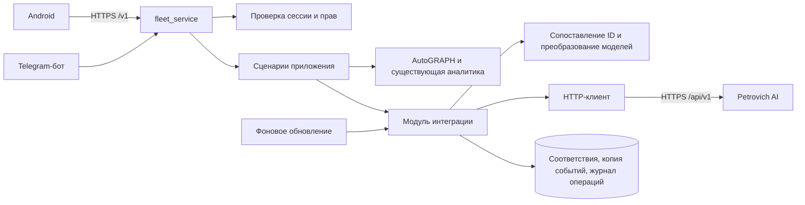
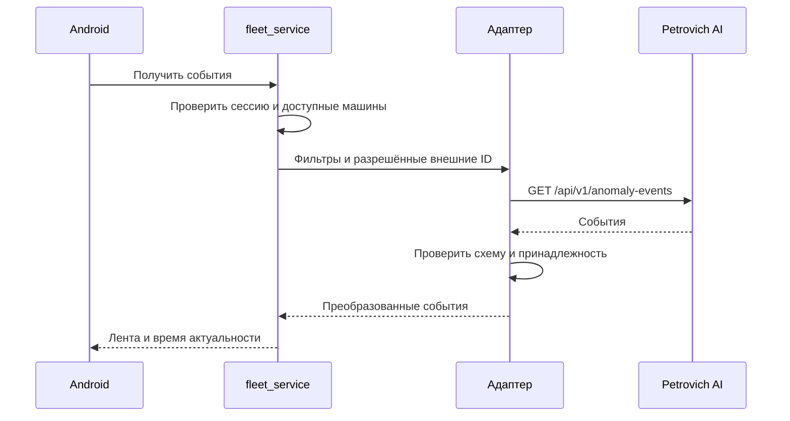

# Подключение Petrovich AI к приложению «Петрович»

Статус: проект интеграции. Код не изменён, внешний сервер не проверялся.

## 1. Задача и границы

Подключить систему из репозитория `ErmakovDenis/petrovich` к API Petrovich AI 0.1.0.

Данные внешнего сервиса должны быть доступны в приложении: лента событий, карточка события, решения проверяющих, затем телеметрия и аналитика.

Рабочее допущение: Petrovich AI — отдельный сервис, а система из репозитория — его потребитель. Совпадение названий не подтверждает совместимость систем.

Первая поставка:

- сопоставление машин;
- получение внешних событий;
- отображение событий в приложении;
- подтверждение и отклонение события;
- обработка конфликтов и сбоев связи.

Телеметрия, внешний чат, запуск детектирования, рассылки и перенос фоновых задач требуют отдельных согласованных контрактов. Полная замена существующего сервера в первую поставку не входит.

## 2. Источники

Проанализирован коммит:

https://github.com/ErmakovDenis/petrovich/tree/f2c07c02bbc30186943c593c93120a0f5ac36a51

Основные файлы:

| Файл | Что проверено |
|---|---|
| `README.md` | Сценарии приложения, стек, источники данных |
| `ml/fleet_service/README.md` | Серверные функции и контракты |
| `app/src/main/java/ru/petrovich/telemetry/data/StandClient.kt` | HTTP-вызовы Android, заголовки, ошибки |
| `app/src/main/java/ru/petrovich/telemetry/data/Models.kt` | Машины, телеметрия, время, карта |
| `app/src/main/java/ru/petrovich/telemetry/anomaly/Anomaly.kt` | Идентификаторы, важность, решения |
| `app/src/main/java/ru/petrovich/telemetry/anomaly/StandAnomalies.kt` | Лента, проверка, решения, импорт истории |
| `app/src/main/java/ru/petrovich/telemetry/chat/RemoteChatAgent.kt` | Запросы к ассистенту |
| `ml/fleet_service/src/fleet_service/api/deps.py` | Проверка сессии и схемы, автор решения |
| `ml/fleet_service/src/fleet_service/api/anomalies.py` | Серверная обработка аномалий |
| `ml/fleet_service/src/fleet_service/analytics/client.py` | Вызовы predictive_antifraud |

Дополнительный источник: предоставленная OpenAPI-спецификация Petrovich AI 0.1.0, OpenAPI 3.1.0 — 49 путей, 51 операция.

Выводы о текущем состоянии основаны на этих материалах. Новые компоненты, таблицы и правила ниже — предложения к реализации.

## 3. Текущее состояние

В репозитории есть Android-приложение на Kotlin и Jetpack Compose и сервер `fleet_service` на FastAPI.

Сервер:

- получает телеметрию AutoGRAPH;
- агрегирует данные;
- проверяет аномалии;
- хранит решения;
- выполняет фоновые задачи;
- обслуживает чат, письма и Telegram-интеграцию.

Android использует контракт сервера:

```text
GET  /v1/vehicles
GET  /v1/telemetry
GET  /v1/anomalies
POST /v1/anomalies/scan
POST /v1/anomalies/{id}/resolve
POST /v1/chat
```

Запросы приложения передают сессию AutoGRAPH и выбранную схему:

```http
Authorization: Bearer <AutoGRAPH session>
X-Schema-Id: <schema id>
```

Petrovich AI предоставляет другой контракт:

```text
GET  /api/v1/vehicles
GET  /api/v1/anomaly-events
POST /api/v1/anomaly-events/{event_id}/review
GET  /api/v1/vehicle/{vehicle_id}/points
POST /api/v1/agent/ask
```

Замены адреса в настройках приложения недостаточно: различаются модели, идентификаторы, права и семантика операций.

## 4. Различия контрактов

| Область | petrovich | Petrovich AI | Требуемая работа |
|---|---|---|---|
| ID машины | Строка | Целое число | Реестр соответствий |
| Машина | `id`, `name`, `group` | `id`, `plate`, `model`, `pump_model` | Преобразование модели |
| Телеметрия | Категории, колонки, временные метки | Схема `/points` не раскрыта | Согласование полей и агрегации |
| Время | Локальное время без пояса и `utcOffsetMinutes` | Правила пояса не описаны | Согласование временной политики |
| Важность | `INFO`, `WARNING`, `CRITICAL` | `low`, `med`, `high`; в QueryArgs — `medium` | Таблица преобразования |
| Решение | `CONFIRMED`, `FALSE_ALARM`; Android также содержит `IN_PROGRESS` | У событий: `new`, `confirmed`, `dismissed` | Разделение проверки и работы по событию |
| ID события | Структурированная строка | Целое число | Явный источник и внешний ID |
| Проверка | `/scan` принимает машины и период | `/detect/{vehicle_id}` не принимает период | Уточнение семантики запуска |
| Чат | `messages`, `anomalyId`, `allowEmail`; ответ `reply`, `drafts` | `question`, `history`, `session_id`; ответ не типизирован | Отдельная адаптация |
| Доступ | AutoGRAPH-сессия и схема | Не описан | Согласование авторизации |
| Фоновые функции | Проверки, доступ устройств, уведомления, письма | Другие маршруты и модели | Поэтапная интеграция |

`StandClient` принимает как успех только HTTP 200 и предоставляет GET/POST.

Для прямой работы с внешними подписчиками потребовались бы также HTTP 201/204, PATCH и DELETE. При серверной интеграции эти различия обрабатывает новый серверный клиент.

## 5. Архитектурное решение

Добавить модуль интеграции в существующий `fleet_service`.

Он вызывает Petrovich AI, проверяет ответы и преобразует их в контракт приложения. Android продолжает работать через `fleet_service`; изменения клиента затрагивают модель источника события и поддерживаемые действия.

| Вариант | Оценка |
|---|---|
| Android напрямую вызывает Petrovich AI | Потребует переноса преобразований и отдельной авторизации в клиент. Существенно затронет приложение |
| Адаптер внутри fleet_service | Использует существующие сценарии, проверку прав и серверное сопровождение. Выбран для первой версии |
| Отдельный интеграционный микросервис | Добавит развёртывание и сетевую зависимость. На текущем объёме не требуется |
| Замена fleet_service | Требует переноса функций, для которых во внешнем API нет подтверждённого аналога |



### 5.1. Владение данными

| Данные | Источник истины |
|---|---|
| Доступные пользователю машины AutoGRAPH | Существующий механизм доступа fleet_service |
| Соответствия идентификаторов | Реестр интеграции |
| Внешнее событие и решение по нему | Petrovich AI |
| Событие существующего детектора | Текущее хранилище fleet_service |
| Отметка «просмотрено» | Устройство |
| Назначение исполнителя и состояние «в работе» | Процесс приложения до появления внешнего контракта |

Локальная копия внешнего события служит для чтения и работы без сети. Изменение решения считается завершённым после подтверждения Petrovich AI.

## 6. Сопоставление машин и права

Предлагаемая таблица `external_vehicle_links`:

| Поле | Назначение |
|---|---|
| `connection_id` | Подключение к экземпляру Petrovich AI |
| `schema_id` | Схема AutoGRAPH |
| `autograph_vehicle_id` | Строковый ID машины приложения |
| `external_vehicle_id` | ID машины внешнего API |
| `external_organization_id` | Организация, если применимо |
| `verification_status` | Предложено, подтверждено или отклонено |
| `verified_at` | Время подтверждения |
| `verified_by` | Кто подтвердил |

Соответствия должны быть однозначными в пределах подключения и схемы.

Госномер можно использовать для поиска кандидата, но подтверждение требуется отдельно: форматы, дубли и исторические изменения могут привести к ошибке.

Проверка доступа выполняется для каждого запроса:

1. Проверить сессию и доступность схемы.
2. Получить машины пользователя.
3. Найти подтверждённые внешние соответствия.
4. Запросить данные Petrovich AI.
5. Проверить принадлежность каждой возвращённой записи.
6. Передать разрешённые данные приложению или ассистенту.

Query-фильтры `vehicle_id` и `organization_id` не подтверждают авторизацию.

Если Petrovich AI не ограничивает доступ сам, он должен быть доступен только доверенному серверному клиенту. Кэш необходимо разделять по подключению и области прав.

## 7. События, идентификаторы и решения

### 7.1. Семейство API

Для проверки событий использовать `/api/v1/anomaly-events`: оно предусматривает автора, примечание, историю и `expected_status`.

`/api/v1/anomalies/*` — отдельное семейство с другой моделью статусов и объединением дубликатов.

Связь между двумя семействами спецификация не определяет. Смешивать их записи без подтверждённого соответствия нельзя.

### 7.2. Идентичность

В Android `kind` извлекается из ID, а `isStandId` определяется окончанием строки `Z`.

Для внешних событий нужны явные поля:

```text
sourceSystem
sourceConnectionId
externalEventId
kind
```

Внутренний ключ внешнего события:

```text
petrovich-ai:<connection_id>:event:<external_event_id>
```

Ключ не меняется при обновлении статуса или повторном получении события.

Внешние события и результаты текущих правил первоначально хранятся раздельно, с указанием источника. Объединение по похожему тексту и близкому времени не допускается без отдельного правила сопоставления.

### 7.3. Статусы

| Petrovich AI | Модель приложения |
|---|---|
| `new` | Решение не принято |
| `confirmed` | `CONFIRMED` |
| `dismissed` | `FALSE_ALARM` |

`resolved` из `/anomalies` не является эквивалентом `confirmed`: закрытие и подтверждение достоверности — разные действия.

`IN_PROGRESS` не имеет прямого соответствия в контракте событий.

Предлагается разделить два состояния:

```text
review_status:   NEW | CONFIRMED | DISMISSED
workflow_status: OPEN | IN_PROGRESS | CLOSED
```

Первое описывает проверку достоверности, второе — работу по событию.

Разделение требует изменения модели приложения; во внешнем API второго состояния сейчас нет.

### 7.4. Важность

| Внешнее значение | Приложение |
|---|---|
| `low` | `INFO` |
| `med` | `WARNING` |
| `high` | `CRITICAL` |

Таблицу необходимо подтвердить с владельцем продукта: важность влияет на уведомления и тихие часы.

`medium` обрабатывается только там, где это согласовано контрактом.

Неизвестное значение фиксируется как ошибка совместимости, без молчаливого понижения важности.

## 8. Потоки взаимодействия

### 8.1. Получение ленты



Для общей ленты нескольких источников нужна единая серверная выборка: общий порядок сортировки, подсчёт и пагинация по сохранённой проекции событий.

Сложение отдельных страниц и их `total` не даёт корректной общей пагинации.

### 8.2. Запись решения

1. Клиент отправляет решение и статус, который видел пользователь.
2. fleet_service проверяет доступ к событию и его машине.
3. Адаптер отправляет запрос проверки.
4. После подтверждения обновляет локальную копию.
5. При конфликте возвращает актуальное состояние. Пользователь повторно принимает решение.

```http
POST /api/v1/anomaly-events/{event_id}/review
Content-Type: application/json
```

```json
{
  "status": "confirmed",
  "reviewed_by": "operator",
  "note": "Проверено по телеметрии",
  "expected_status": "new"
}
```

Код и тело ответа при конфликте необходимо согласовать с владельцем API. Предположение о HTTP 409 без проверки реализации недопустимо.

`reviewed_by` должен формироваться из проверенного контекста пользователя.

Сейчас fleet_service принимает имя из `X-User-Name` без проверки личности автора. Для достоверного аудита этого недостаточно.

### 8.3. Фоновое обновление

В спецификации не заявлены курсор изменений, `updated_since` и webhooks.

Первый вариант — периодическое получение событий и повторное чтение статусов известных записей. Для гарантированного получения всех изменений нужен согласованный механизм синхронизации.

Повторный опрос не должен создавать новые ID или повторные уведомления.

Получение событий, время последнего успешного обновления и отметка доставки уведомления учитываются отдельно.

## 9. Телеметрия

Подключение `/api/v1/vehicle/{vehicle_id}/points` блокируется отсутствием схемы ответа.

До реализации требуется определить:

- поля точки и метаданные параметров;
- единицы измерения;
- часовой пояс и точность временных меток;
- отсутствие датчика, пропуски и признаки качества;
- сортировку и пагинацию;
- обработку дубликатов;
- наличие и формат координат.

Преобразование в модель приложения:

```text
Точки API
→ проверка схемы
→ нормализация времени и единиц
→ обработка дубликатов
→ агрегация
→ CategoryTable
→ VehicleTelemetry
```

Требования:

- Отсутствующее значение сохраняется как `null`, а не ноль.
- Способ агрегации определяется смыслом параметра.
- Для графика загружается полный запрошенный период с учётом страниц.
- Внутри интеграции предлагается использовать UTC и интервалы `[from, to)`.
- Если API принимает только даты, адаптер получает охватывающие дни и обрезает точки по точному периоду после согласования пояса.

`RoutePoint` в приложении использует условные координаты. Для реальных GPS-данных нужны отдельная модель и изменения карты.

## 10. Детектирование и ассистент

### 10.1. Детектирование

Внешний `/detect/{vehicle_id}` не принимает временное окно.

Он не заменяет существующий `/scan`, пока не определены:

- период расчёта;
- сохранение результатов;
- поведение при повторном запуске;
- состав детекторов.

На первом этапе существующая проверка сохраняется. Из Petrovich AI читаются готовые события. Открытие экрана не запускает внешний детектор.

Текущий `AnalyticsClient` также несовместим с предоставленным API: он ожидает `/v1/predictive/analyze`, `/v1/antifraud/check` и `DetectionResponse`. Замены URL недостаточно.

### 10.2. Ассистент

Сохранить текущий чат и добавить инструменты чтения внешних событий:

```text
list_external_events
get_external_event
get_external_review_history
```

Каждый инструмент использует ту же проверку прав, что и экран приложения. Модель не получает данные недоступных машин.

Переход на `/api/v1/agent/ask` требует контракта ответа, управления историей, контекста события и действий.

Текущие письма с подтверждением пользователя не имеют описанного эквивалента в этом методе.

Внешняя сессия чата должна быть привязана к пользователю, схеме и подключению.

Для `/stream` необходимо определить протокол: в спецификации указан `application/json` с пустой схемой.

## 11. Ошибки и согласованность

| Ситуация | Поведение |
|---|---|
| Таймаут чтения | Последняя копия с отметкой актуальности |
| Неверная структура ответа | Ошибка контракта; не показывать пустую ленту как отсутствие проблем |
| Внешние 401/403 | Ошибка внешнего доступа; не запускать повторный вход в AutoGRAPH |
| 429 | Учитывать Retry-After и ограничивать повторные обращения |
| 5xx | Ограниченные повторы чтения; временно прекращать вызовы после серии сбоев |
| Потерян ответ на запись | Перечитать состояние и историю; не повторять изменение вслепую |
| Конфликт решения | Показать актуальное состояние |
| Нет соответствия машины | Зафиксировать причину; не связывать данные предположительно |

Журнал изменяющих операций:

```text
operation_id
actor_id
external_event_id
requested_status
expected_status
state: PENDING | SUCCEEDED | FAILED | UNKNOWN
created_at
completed_at
```

`UNKNOWN` означает, что сервер мог выполнить запрос, но подтверждение не получено.

Приложение не показывает успех до проверки результата.

Для однозначного восстановления после таких сбоев желательно согласовать ключ идемпотентности или внешний идентификатор операции.

## 12. Изменения кода

Предлагаемая структура:

```text
ml/fleet_service/src/fleet_service/
  integrations/
    petrovich_ai/
      client.py       # HTTP, таймауты, повторы
      dto.py          # схемы внешнего API
      mappings.py     # типы, статусы, важность
      vehicles.py     # соответствия машин
      events.py       # получение событий
      reviews.py      # запись решений
      errors.py       # ошибки интеграции
  store/
    external_links.py
    external_events.py
    integration_operations.py
```

| Компонент | Изменение |
|---|---|
| Конфигурация | URL, доступ, таймауты, включённые возможности |
| Зависимости сервера | Создание клиента и адаптера |
| Сервис ленты | Внешние события, права, общая пагинация |
| Хранилище | Соответствия ID, копия событий, операции |
| Android Anomaly | Явные sourceSystem, kind и внешний ID |
| Карточка события | Источник, актуальность, доступные действия |
| Настройки | Состояние подключения без серверных секретов |
| Фоновые задачи | Получение событий и контроль актуальности |

Источник данных выбирается на сервере для подключения.

Существующие переключатели Android управляют обращением к fleet_service и не должны превращаться в набор независимых несовместимых режимов.

## 13. Эксплуатационные требования

- Секреты Petrovich AI хранятся на сервере и не включаются в APK.
- Кэш изолируется по подключению и правам. Смена прав не должна открывать прежнюю копию чужих данных.
- В логах нет токенов и паролей. Доступ к журналу решений ограничен.
- Пользователь различает «событий нет» и «данные не получены».
- Сбой внешнего сервиса не блокирует существующие функции.
- Наблюдаются задержка запросов, ошибки контракта, ошибки доступа, конфликты решений и время последнего успешного обновления.
- Массовые операции повторно проверяют полномочия.
- Изменение правил преобразования фиксируется версией.

Целевые задержки и пределы нагрузки определяются после получения числа машин, числа пользователей, частоты обновления и замеров внешнего API.

## 14. Внедрение и приёмка

| Этап | Результат | Критерий приёмки |
|---|---|---|
| 1. Контракты | Доступ, реальные ответы, время, ошибки | Согласованы схемы и примеры |
| 2. Машины | Реестр соответствий и права | Чужие и несопоставленные машины не попадают в ответ |
| 3. События | Лента и карточка | Стабильные ID; сбой не выглядит как отсутствие проблем |
| 4. Решения | Подтверждение, отклонение, возврат в новые | Конфликт не перезаписывает решение; таймаут не создаёт ложный успех |
| 5. Обновление | Актуальность и уведомления | Повторное получение не создаёт повторных уведомлений |
| 6. Телеметрия | Графики и показатели | Проверены единицы, время, полнота и отсутствующие датчики |
| 7. Ассистент | Инструменты чтения событий | Используются только разрешённые данные |
| 8. Пилот | Работа ограниченной группы | Проверены сбои и возврат к прежней конфигурации |

Обязательные сценарии проверки:

1. Повторное получение события не меняет ID и не создаёт дубль.
2. Пользователь не видит события чужой схемы, включая кэш и ответы ассистента.
3. Два проверяющих одновременно выбирают разные решения.
4. Внешняя запись выполнена, но соединение оборвано до ответа.
5. API вернул неизвестный тип события или изменил структуру.
6. Телеметрия пересекает полночь и смену смещения времени.
7. Полная выборка требует нескольких страниц.
8. Перенос истории не применяет решение к другому похожему событию.
9. Отключение интеграции не удаляет историю и не запускает повторную отправку уведомлений.

## 15. Что требуется уточнить

| Вопрос | На что влияет |
|---|---|
| URL и авторизация Petrovich AI | Доступ и управление секретами |
| Изоляция организаций и пользователей | Защита данных |
| Связь anomalies и anomaly-events | Идентичность и жизненный цикл события |
| Схемы ответов событий, карточки и points | Преобразование данных |
| Ответ при несовпадении expected_status | Конкурентное принятие решений |
| Период и побочные эффекты detect | Ручная и фоновая проверка |
| Курсор изменений, обновления и удаления | Полнота синхронизации |
| Часовой пояс и временные границы | Графики, фильтры, расчёты |
| Покрытие типов событий | Возможность замены существующих детекторов |
| Поддержка идемпотентности | Восстановление после неопределённого результата записи |
| Объём парка и частота обращений | Нагрузка и целевые задержки |

К разработке чтения событий можно переходить после согласования авторизации, прав, соответствий машин и схем ответов.

Запись решений дополнительно требует определённого поведения при конфликте и потере ответа.